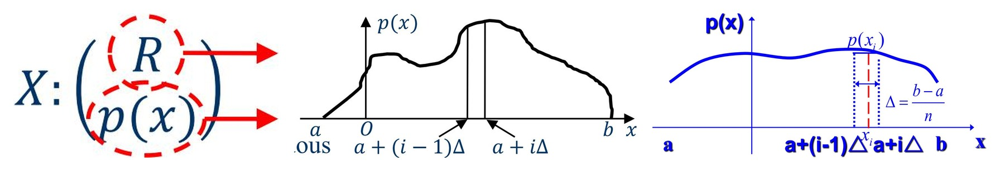
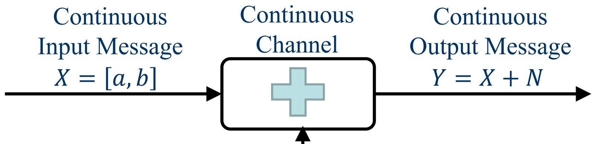

# 10 Continuous Information Source and Channel Capacity

<LyricCover
  image="IT-Lecture-10.attachments/1783256314706.jpg"
  title="エガクミライ"
  artist="MyGO!!!!!"
  lang="ja"
  furigana="hide"
  netease-url="https://music.163.com/#/song?id=2741315465"
>
  <LyricLine
    original="描(えが)く未来(みらい)　広(ひろ)がる世界(せかい)　約束(やくそく)の花(はな)は散(ち)れども"
    translation="描绘中的未来 更宽阔的世界 纵使约定之花纷落飘散"
  />
  <LyricLine
    original="僕(ぼく)らはきっと　大丈夫(だいじょうぶ)だよ"
    translation="我们之后也一定会安然无恙"
  />
</LyricCover>

## 章节目录

- [章节目录](#章节目录)
- [10-1 连续信源 Continuous Information Source](#10-1-连续信源-continuous-information-source)
  - [10-1-1 随机过程模型 Stochastic Process Model](#10-1-1-随机过程模型-stochastic-process-model)
  - [10-1-2 连续随机变量 Continuous Random Variables](#10-1-2-连续随机变量-continuous-random-variables)
  - [10-1-3 从离散化到微分熵 From Discretization to Differential Entropy](#10-1-3-从离散化到微分熵-from-discretization-to-differential-entropy)
- [10-2 常见连续分布微分熵 Common Differential Entropies](#10-2-常见连续分布微分熵-common-differential-entropies)
  - [10-2-1 均匀分布 Uniform Distribution](#10-2-1-均匀分布-uniform-distribution)
  - [10-2-2 Gaussian 分布 Gaussian Distribution](#10-2-2-gaussian-分布-gaussian-distribution)
  - [10-2-3 指数分布 Exponential Distribution](#10-2-3-指数分布-exponential-distribution)
  - [10-2-4 多维连续信源 Multidimensional Continuous Source](#10-2-4-多维连续信源-multidimensional-continuous-source)
- [10-3 微分熵性质与最大熵 Properties and Maximum Entropy](#10-3-微分熵性质与最大熵-properties-and-maximum-entropy)
  - [10-3-1 联合、条件与互信息 Joint, Conditional and Mutual Information](#10-3-1-联合条件与互信息-joint-conditional-and-mutual-information)
  - [10-3-2 微分熵的性质 Properties of Differential Entropy](#10-3-2-微分熵的性质-properties-of-differential-entropy)
  - [10-3-3 最大熵结论 Maximum Entropy Results](#10-3-3-最大熵结论-maximum-entropy-results)
- [10-4 连续信道容量 Continuous Channel Capacity](#10-4-连续信道容量-continuous-channel-capacity)
  - [10-4-1 连续信道容量定义 Definition](#10-4-1-连续信道容量定义-definition)
  - [10-4-2 加性信道 Additive Channel](#10-4-2-加性信道-additive-channel)
  - [10-4-3 Shannon 容量公式 Shannon Capacity Formula](#10-4-3-shannon-容量公式-shannon-capacity-formula)
  - [10-4-4 带宽与 SNR 例题 Bandwidth and SNR Example](#10-4-4-带宽与-snr-例题-bandwidth-and-snr-example)

## 10-1 连续信源 Continuous Information Source

### 10-1-1 随机过程模型 Stochastic Process Model

连续信源在连续时间上产生连续取值的消息，可表示为随机过程：

$$
\{X(t)\}.
$$

某一样本函数 $x(t)$ 的时间平均为：

$$
\bar x_t
=
\lim_{T\to\infty}
\frac{1}{2T}
\int_{-T}^{T}x(t)\,dt.
$$

固定时刻 $t_i$ 的随机变量为 $X_{t_i}$，其集合平均为：

$$
E[X_{t_i}]
=
\int_{-\infty}^{\infty}
x p(x)\,dx.
$$

**平稳过程 Stationary Process** 指不同时刻随机变量的统计性质相同。

**各态历经过程 Ergodic Process** 指平稳过程的时间平均与集合平均以概率 $1$ 相等：

$$
\bar x_t=E[X_{t_i}].
$$

实际连续通信信号常用平稳、各态历经假设把长时间观测与概率平均联系起来。

---

### 10-1-2 连续随机变量 Continuous Random Variables

连续随机变量 $X$ 的分布函数为：

$$
F_X(x)
=
\Pr(X\le x)
=
\int_{-\infty}^{x}p_X(u)\,du.
$$

概率密度函数为：

$$
p_X(x)
=
\frac{dF_X(x)}{dx}.
$$

联合概率密度为：

$$
p_{XY}(x,y)
=
\frac{\partial^2F_{XY}(x,y)}{\partial x\partial y}.
$$

边缘密度由积分得到：

$$
p_X(x)
=
\int_{-\infty}^{\infty}p_{XY}(x,y)\,dy,
\qquad
p_Y(y)
=
\int_{-\infty}^{\infty}p_{XY}(x,y)\,dx.
$$

联合密度、条件密度和边缘密度满足：

$$
p_{XY}(x,y)
=
p_X(x)p_{Y\mid X}(y\mid x)
=
p_Y(y)p_{X\mid Y}(x\mid y).
$$

---

### 10-1-3 从离散化到微分熵 From Discretization to Differential Entropy

设连续随机变量 $X$ 的取值范围为 $[a,b]$，并把区间划分为 $n$ 个小区间：

$$
\Delta=\frac{b-a}{n}.
$$

第 $i$ 个小区间近似概率为：

$$
\Pr(a+(i-1)\Delta\le X<a+i\Delta)
\approx
p(x_i)\Delta.
$$

把连续变量近似为离散变量时，其离散熵为：

$$
\begin{aligned}
H_\Delta(X)
&=
-\sum_{i=1}^{n}
p(x_i)\Delta
\log_2\left[p(x_i)\Delta\right]\\
&=
-\sum_{i=1}^{n}
p(x_i)\Delta\log_2p(x_i)
-
\log_2\Delta
\sum_{i=1}^{n}p(x_i)\Delta.
\end{aligned}
$$

令 $\Delta\to0$：

$$
H_\Delta(X)
=
h(X)-\log_2\Delta.
$$

其中：

$$
\boxed{
h(X)
=
-
\int_{-\infty}^{\infty}
p(x)\log_2p(x)\,dx
}
$$

称为**微分熵 Differential Entropy**。

离散化后的绝对熵 $H_\Delta(X)$ 会随 $\Delta\to0$ 发散。微分熵保留了形式上的熵表达式，但它本身不直接表示连续信源的绝对平均不确定性。

## 10-2 常见连续分布微分熵 Common Differential Entropies

### 10-2-1 均匀分布 Uniform Distribution

设：

$$
p(x)
=
\begin{cases}
\dfrac{1}{b-a}, & a\le x\le b,\\
0, & \mathrm{otherwise}.
\end{cases}
$$

则：

$$
\begin{aligned}
h(X)
&=
-
\int_a^b
\frac{1}{b-a}
\log_2\frac{1}{b-a}\,dx\\
&=
\log_2(b-a).
\end{aligned}
$$

因此：

$$
\boxed{
h(X)=\log_2(b-a)
}.
$$

若 $b-a<1$，则 $h(X)<0$。微分熵可以为负。

---

### 10-2-2 Gaussian 分布 Gaussian Distribution

设 $X\sim\mathcal N(m,\sigma^2)$：

$$
p(x)
=
\frac{1}{\sqrt{2\pi\sigma^2}}
\exp\left[
-\frac{(x-m)^2}{2\sigma^2}
\right].
$$

其中：

$$
m=E[X],
\qquad
\sigma^2=E[(X-m)^2].
$$

代入微分熵定义：

$$
\begin{aligned}
h(X)
&=
-
\int_{-\infty}^{\infty}
p(x)\log_2p(x)\,dx\\
&=
\log_2\sqrt{2\pi\sigma^2}
+
\frac12\log_2 e.
\end{aligned}
$$

故：

$$
\boxed{
h(X)
=
\frac12\log_2(2\pi e\sigma^2)
}.
$$

当 $m=0$ 时，$\sigma^2$ 等于平均功率：

$$
\sigma^2=E[X^2]=P.
$$

---

### 10-2-3 指数分布 Exponential Distribution

设 $X$ 服从均值为 $m$ 的指数分布：

$$
p(x)
=
\frac{1}{m}e^{-x/m},
\qquad
x\ge0.
$$

其中：

$$
m=E[X].
$$

微分熵为：

$$
\begin{aligned}
h(X)
&=
-
\int_0^\infty
\frac{1}{m}e^{-x/m}
\log_2\left(
\frac{1}{m}e^{-x/m}
\right)\,dx\\
&=
\log_2m+\log_2e.
\end{aligned}
$$

因此：

$$
\boxed{
h(X)=\log_2(em)
}.
$$

指数分布的微分熵只由均值 $m$ 决定。

---

### 10-2-4 多维连续信源 Multidimensional Continuous Source

设随机向量：

$$
\boldsymbol X
=
(X_1,X_2,\cdots,X_N).
$$

其联合微分熵定义为：

$$
h(\boldsymbol X)
=
-
\int_{\mathbb R^N}
p(\boldsymbol x)\log_2p(\boldsymbol x)\,d\boldsymbol x.
$$

若各分量独立，则：

$$
\boxed{
h(X_1,X_2,\cdots,X_N)
=
\sum_{i=1}^{N}h(X_i)
}.
$$

若 $X_i$ 独立且均匀分布于 $[a_i,b_i]$，则：

$$
p(\boldsymbol x)
=
\frac{1}{\prod_{i=1}^{N}(b_i-a_i)}
$$

并且：

$$
h(\boldsymbol X)
=
\log_2
\prod_{i=1}^{N}(b_i-a_i)
=
\sum_{i=1}^{N}\log_2(b_i-a_i).
$$

## 10-3 微分熵性质与最大熵 Properties and Maximum Entropy

### 10-3-1 联合、条件与互信息 Joint, Conditional and Mutual Information

连续随机变量的联合微分熵为：

$$
h(X,Y)
=
-
\iint
p(x,y)\log_2p(x,y)\,dx\,dy.
$$

条件微分熵为：

$$
h(Y\mid X)
=
-
\iint
p(x,y)\log_2p(y\mid x)\,dx\,dy.
$$

链式法则仍成立：

$$
h(X,Y)
=
h(X)+h(Y\mid X)
=
h(Y)+h(X\mid Y).
$$

连续随机变量之间的互信息定义为：

$$
\boxed{
I(X;Y)
=
h(X)-h(X\mid Y)
=
h(Y)-h(Y\mid X)
}.
$$

也可写成密度比形式：

$$
I(X;Y)
=
\iint
p(x,y)
\log_2
\frac{p(x,y)}{p(x)p(y)}
\,dx\,dy.
$$

互信息满足：

$$
I(X;Y)\ge0.
$$

微分熵可能为负，但互信息仍具有信息量意义。

---

### 10-3-2 微分熵的性质 Properties of Differential Entropy

微分熵与离散熵形式相似，但性质不同：

| 性质 Property | 离散熵 Entropy | 微分熵 Differential Entropy |
| --- | --- | --- |
| 非负性 | $H(X)\ge0$ | $h(X)$ 可为负 |
| 坐标变换 | 与符号重命名无关 | 会随尺度变换改变 |
| 独立可加性 | 成立 | 成立 |
| 互信息构造 | $I(X;Y)=H(X)-H(X\mid Y)$ | $I(X;Y)=h(X)-h(X\mid Y)$ |

若 $Y=aX$，则：

$$
h(Y)=h(X)+\log_2|a|.
$$

因此微分熵依赖度量单位。连续信源分析中，真正稳定的信息量通常来自熵差或互信息。

---

### 10-3-3 最大熵结论 Maximum Entropy Results

在不同约束下，最大微分熵对应不同分布。

若随机变量限制在 $[a,b]$，则均匀分布使微分熵最大：

$$
\boxed{
h(X)
\le
\log_2(b-a)
}.
$$

等号成立当且仅当：

$$
p(x)=\frac{1}{b-a},
\qquad
a\le x\le b.
$$

若随机变量均值为 $0$、方差为 $\sigma^2$，则 Gaussian 分布使微分熵最大：

$$
\boxed{
h(X)
\le
\frac12\log_2(2\pi e\sigma^2)
}.
$$

若随机变量非负且均值为 $m$，则指数分布使微分熵最大：

$$
\boxed{
h(X)
\le
\log_2(em)
}.
$$

连续信源没有不带约束的统一最大熵。最大熵结论必须和约束一起使用。

对零均值信号，可定义**熵功率 Entropy Power**：

$$
P_e(X)
=
\frac{1}{2\pi e}2^{2h(X)}.
$$

若 $X$ 为 Gaussian 且平均功率为 $P$，则：

$$
P_e(X)=P.
$$

非 Gaussian 信号在同样平均功率下有更小的熵功率。

## 10-4 连续信道容量 Continuous Channel Capacity

### 10-4-1 连续信道容量定义 Definition

连续信道由输入随机变量 $X$、输出随机变量 $Y$ 以及条件密度 $p(y\mid x)$ 描述。

信道容量定义为：

$$
\boxed{
C
=
\max_{p(x)}I(X;Y)
}.
$$

利用微分熵：

$$
C
=
\max_{p(x)}
\{h(Y)-h(Y\mid X)\}.
$$

若从输入端看，也可写为：

$$
C
=
\max_{p(x)}
\{h(X)-h(X\mid Y)\}.
$$

具体求容量时，需要同时考虑输入分布约束。例如平均功率约束、峰值功率约束或带宽约束。

---

### 10-4-2 加性信道 Additive Channel

加性信道模型为：

$$
Y=X+N.
$$

其中 $N$ 是噪声，且与 $X$ 独立。给定 $X=x$ 后：

$$
Y=x+N.
$$

平移不改变微分熵，因此：

$$
h(Y\mid X)
=
h(N).
$$

容量为：

$$
\boxed{
C
=
\max_{p(x)}h(Y)-h(N)
}.
$$

若噪声分布固定，求容量的关键是让输出 $Y$ 的微分熵尽可能大。

---

### 10-4-3 Shannon 容量公式 Shannon Capacity Formula

设噪声为零均值 Gaussian 噪声：

$$
N\sim\mathcal N(0,\sigma_N^2).
$$

其概率密度为：

$$
p(n)
=
\frac{1}{\sqrt{2\pi\sigma_N^2}}
\exp\left(
-\frac{n^2}{2\sigma_N^2}
\right).
$$

噪声微分熵为：

$$
h(N)
=
\frac12\log_2(2\pi e\sigma_N^2).
$$

若输入平均功率受限：

$$
E[X^2]\le P_X,
$$

则输出平均功率为：

$$
P_Y=P_X+P_N.
$$

在固定方差下，Gaussian 分布微分熵最大。因此最优输入也取 Gaussian 分布：

$$
X\sim\mathcal N(0,P_X).
$$

于是每个实值信道使用的容量为：

$$
\begin{aligned}
C
&=
\frac12\log_2(2\pi e(P_X+P_N))
-
\frac12\log_2(2\pi eP_N)\\
&=
\boxed{
\frac12\log_2\left(1+\frac{P_X}{P_N}\right)
}.
\end{aligned}
$$

若带宽为 $W$，每秒可传输 $2W$ 个独立实值采样，则 Shannon 容量为：

$$
\boxed{
C_t
=
W\log_2\left(1+\frac{P_X}{P_N}\right)
}
\qquad
(\mathrm{bit/s}).
$$

若噪声功率为：

$$
P_N=N_0W,
$$

则：

$$
C_t
=
W\log_2\left(1+\frac{P_X}{N_0W}\right).
$$

当 $W\to\infty$：

$$
\boxed{
\lim_{W\to\infty}C_t
=
\frac{P_X}{N_0}\log_2e
}.
$$

无限带宽下容量仍有限，极限由信号功率和噪声谱密度决定。

---

### 10-4-4 带宽与 SNR 例题 Bandwidth and SNR Example

已知 AWGN 信道带宽：

$$
B=3\ \mathrm{kHz},
$$

要求最大信息传输率：

$$
C_t=1.5\times10^4\ \mathrm{bit/s}.
$$

由 Shannon 公式：

$$
C_t
=
B\log_2(1+\mathrm{SNR}).
$$

代入：

$$
1.5\times10^4
=
3\times10^3
\log_2(1+\mathrm{SNR}).
$$

因此：

$$
\log_2(1+\mathrm{SNR})=5.
$$

所以：

$$
\mathrm{SNR}
=
2^5-1
=
31.
$$

换算为 dB：

$$
10\log_{10}31
\approx
14.9\ \mathrm{dB}.
$$

若 SNR 降低到 $8.45\ \mathrm{dB}$：

$$
\mathrm{SNR}
=
10^{8.45/10}
\approx
7.
$$

为了维持同样传输率：

$$
1.5\times10^4
=
B\log_2(1+7)
=
3B.
$$

故所需带宽为：

$$
\boxed{
B=5\ \mathrm{kHz}
}.
$$

同一容量目标下，SNR 降低需要用更大的带宽补偿。
