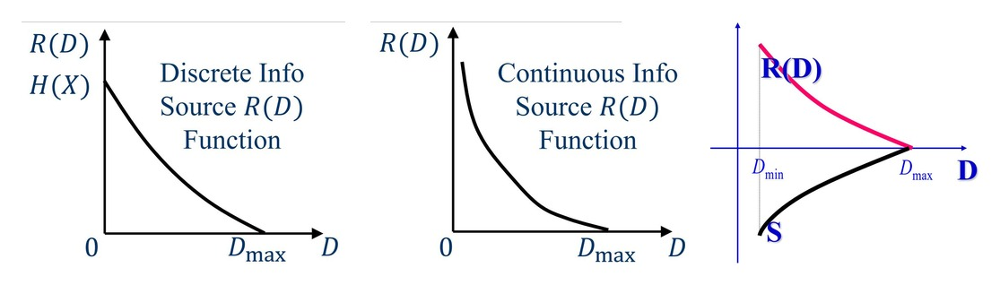
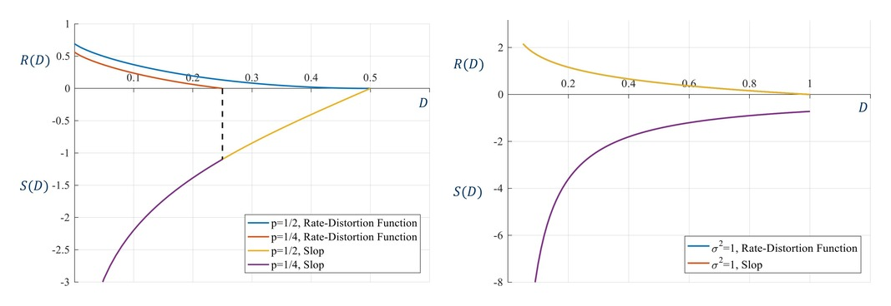

# 11 Rate-Distortion Theory

<LyricCover
  image="IT-Lecture-11.attachments/1783256401032.JPG"
  title="海の見える街"
  artist="mamomo / nayuta"
  lang="ja"
  furigana="hide"
  netease-url="https://music.163.com/#/song?id=29244119"
>
  <LyricLine
    original="いつかまたやり直(なお)せること、出来(でき)ないと知(し)りながら。"
    translation="心想有一天，我们也许能再次相遇。"
  />
  <LyricLine
    original="変(か)わりゆく景色(けしき)を、眺(なが)めていた。"
    translation="眺望着变幻的景色。"
  />
</LyricCover>

## 章节目录

- [章节目录](#章节目录)
- [11-1 率失真问题 Fundamental of Rate-Distortion Theory](#11-1-率失真问题-fundamental-of-rate-distortion-theory)
  - [11-1-1 从无失真到允许失真 From Lossless to Lossy Coding](#11-1-1-从无失真到允许失真-from-lossless-to-lossy-coding)
  - [11-1-2 信道容量与率失真 Channel Capacity and Rate Distortion](#11-1-2-信道容量与率失真-channel-capacity-and-rate-distortion)
- [11-2 失真度量 Distortion Measure](#11-2-失真度量-distortion-measure)
  - [11-2-1 单符号失真 Single-Symbol Distortion](#11-2-1-单符号失真-single-symbol-distortion)
  - [11-2-2 常用失真度量 Typical Distortion Measures](#11-2-2-常用失真度量-typical-distortion-measures)
  - [11-2-3 平均失真与失真约束 Average Distortion and Constraint](#11-2-3-平均失真与失真约束-average-distortion-and-constraint)
  - [11-2-4 扩展信源失真 Expanded Source Distortion](#11-2-4-扩展信源失真-expanded-source-distortion)
- [11-3 信息率失真函数 Rate-Distortion Function](#11-3-信息率失真函数-rate-distortion-function)
  - [11-3-1 试验信道 Trial Channel](#11-3-1-试验信道-trial-channel)
  - [11-3-2 定义域与端点 Domain and Endpoints](#11-3-2-定义域与端点-domain-and-endpoints)
  - [11-3-3 基本性质 Basic Properties](#11-3-3-基本性质-basic-properties)
- [11-4 离散信源率失真函数 Discrete Source Rate-Distortion Function](#11-4-离散信源率失真函数-discrete-source-rate-distortion-function)
  - [11-4-1 拉格朗日参数法 Lagrange Parameter Method](#11-4-1-拉格朗日参数法-lagrange-parameter-method)
  - [11-4-2 二元信源 Binary Source](#11-4-2-二元信源-binary-source)
  - [11-4-3 等概率多元信源 Equally Distributed n-ary Source](#11-4-3-等概率多元信源-equally-distributed-n-ary-source)
- [11-5 连续信源与保真度准则 Continuous Source and Fidelity Criterion](#11-5-连续信源与保真度准则-continuous-source-and-fidelity-criterion)
  - [11-5-1 连续信源率失真函数 Continuous Rate-Distortion Function](#11-5-1-连续信源率失真函数-continuous-rate-distortion-function)
  - [11-5-2 Gaussian 信源 Gaussian Source](#11-5-2-gaussian-信源-gaussian-source)
  - [11-5-3 保真度准则下的信源编码定理 Source Coding Theorem under Fidelity Criterion](#11-5-3-保真度准则下的信源编码定理-source-coding-theorem-under-fidelity-criterion)
  - [11-5-4 三个 Shannon 界 Three Shannon Limits](#11-5-4-三个-shannon-界-three-shannon-limits)

## 11-1 率失真问题 Fundamental of Rate-Distortion Theory

### 11-1-1 从无失真到允许失真 From Lossless to Lossy Coding

无失真信源编码要求译码后完全恢复原消息。对离散平稳无记忆信源，平均信息率必须满足：

$$
R\ge H(X).
$$

有噪信道可靠传输要求：

$$
R<C.
$$

因此无失真、可靠传输同时成立时，需要：

$$
H(X)\le R<C.
$$

连续信源的绝对熵在无限精度下发散。若要求完全无失真，所需信息率趋于无穷大：

$$
\lim_{D\to0}R(D)=\infty.
$$

实际音频、图像和视频允许有限失真。率失真理论讨论的是：在平均失真不超过 $D$ 的条件下，最少需要多少信息率。

---

### 11-1-2 信道容量与率失真 Channel Capacity and Rate Distortion

信道容量固定信道，优化输入分布：

$$
\boxed{
C
=
\max_{p(x)}I(X;Y)
}.
$$

率失真函数固定信源和失真约束，优化试验信道：

$$
\boxed{
R(D)
=
\min_{p(\hat x\mid x)\in P_D}
I(X;\hat X)
}.
$$

两者都是互信息极值问题，但优化对象相反：

| 对象 | 已知条件 | 优化变量 | 结果含义 |
| --- | --- | --- | --- |
| 信道容量 $C$ | 信道 $p(y\mid x)$ | 输入分布 $p(x)$ | 信道允许的最大可靠信息率 |
| 率失真函数 $R(D)$ | 信源 $p(x)$ 与失真约束 | 试验信道 $p(\hat x\mid x)$ | 达到失真 $D$ 所需的最小信息率 |

率失真函数刻画可压缩程度。若允许更大失真，所需信息率更低。

## 11-2 失真度量 Distortion Measure

### 11-2-1 单符号失真 Single-Symbol Distortion

设信源字母表为：

$$
X\in\{a_1,a_2,\cdots,a_n\},
$$

重构字母表为：

$$
\hat X\in\{b_1,b_2,\cdots,b_m\}.
$$

试验信道为：

$$
P(\hat X\mid X)
=
\begin{bmatrix}
p(b_1\mid a_1) & p(b_2\mid a_1) & \cdots & p(b_m\mid a_1)\\
p(b_1\mid a_2) & p(b_2\mid a_2) & \cdots & p(b_m\mid a_2)\\
\vdots & \vdots & \ddots & \vdots\\
p(b_1\mid a_n) & p(b_2\mid a_n) & \cdots & p(b_m\mid a_n)
\end{bmatrix}.
$$

对每一对原符号和重构符号定义非负失真：

$$
d(a_i,b_j)\ge0.
$$

失真矩阵为：

$$
\boldsymbol D
=
\begin{bmatrix}
d(a_1,b_1) & d(a_1,b_2) & \cdots & d(a_1,b_m)\\
d(a_2,b_1) & d(a_2,b_2) & \cdots & d(a_2,b_m)\\
\vdots & \vdots & \ddots & \vdots\\
d(a_n,b_1) & d(a_n,b_2) & \cdots & d(a_n,b_m)
\end{bmatrix}.
$$

---

### 11-2-2 常用失真度量 Typical Distortion Measures

**Hamming 失真 Hamming Distortion** 定义为：

$$
d(a_i,b_j)
=
\begin{cases}
0, & i=j,\\
1, & i\ne j.
\end{cases}
$$

更一般地，可写成常数失真：

$$
d(a_i,b_j)
=
\begin{cases}
0, & i=j,\\
\alpha, & i\ne j.
\end{cases}
$$

对应失真矩阵为：

$$
\boldsymbol D
=
\begin{bmatrix}
0 & \alpha & \cdots & \alpha\\
\alpha & 0 & \cdots & \alpha\\
\vdots & \vdots & \ddots & \vdots\\
\alpha & \alpha & \cdots & 0
\end{bmatrix}.
$$

**平方误差失真 Square-Error Distortion** 定义为：

$$
d(x,\hat x)
=
(x-\hat x)^2.
$$

若符号代表信号幅度，平方误差对应均方误差 MSE。

---

### 11-2-3 平均失真与失真约束 Average Distortion and Constraint

平均失真定义为：

$$
\bar D
=
E[d(X,\hat X)].
$$

对离散信源：

$$
\boxed{
\bar D
=
\sum_{i=1}^{n}
\sum_{j=1}^{m}
p(a_i)p(b_j\mid a_i)d(a_i,b_j)
}.
$$

对 Hamming 失真，$\bar D$ 等于错误概率。

对平方误差失真，$\bar D$ 等于均方误差。

失真约束写为：

$$
\bar D\le D.
$$

在该约束下，寻找最小互信息 $I(X;\hat X)$ 才有意义。

---

### 11-2-4 扩展信源失真 Expanded Source Distortion

对 $N$ 阶扩展信源：

$$
\alpha_i
=
a_{i_1}a_{i_2}\cdots a_{i_N},
\qquad
\beta_j
=
b_{j_1}b_{j_2}\cdots b_{j_N}.
$$

序列失真通常定义为逐符号失真之和：

$$
d(\alpha_i,\beta_j)
=
\sum_{k=1}^{N}
d(a_{i_k},b_{j_k}).
$$

若每个位置统计相同，则扩展信源平均失真为：

$$
\bar D^{(N)}
=
\sum_{k=1}^{N}\bar D_k
=
N\bar D.
$$

因此常把约束写成：

$$
\bar D^{(N)}\le ND.
$$

## 11-3 信息率失真函数 Rate-Distortion Function

### 11-3-1 试验信道 Trial Channel

对给定信源分布 $p(a_i)$ 和失真矩阵 $d(a_i,b_j)$，定义满足失真约束的试验信道集合：

$$
P_D
=
\left\{
p(b_j\mid a_i):
\bar D\le D
\right\}.
$$

信息率失真函数定义为：

$$
\boxed{
R(D)
=
\min_{p(b_j\mid a_i)\in P_D}
I(X;\hat X)
}.
$$

互信息是试验信道转移概率的凸函数，因此该最小化问题具有明确的凸优化结构。

对 $N$ 阶扩展信源：

$$
P_{D}^{(N)}
=
\left\{
p(\beta_j\mid\alpha_i):
\bar D^{(N)}\le ND
\right\}.
$$

其率失真函数为：

$$
R_N(D)
=
\min_{p(\beta_j\mid\alpha_i)\in P_D^{(N)}}
I(X^N;\hat X^N).
$$

对无记忆信源：

$$
\boxed{
R_N(D)=N R(D)
}.
$$

---

### 11-3-2 定义域与端点 Domain and Endpoints

最小失真为：

$$
D_{\min}
=
\sum_i
p(a_i)
\min_j d(a_i,b_j).
$$

若失真矩阵每一行至少有一个 $0$，则：

$$
D_{\min}=0.
$$

当不允许失真时，离散信源需要无失真编码：

$$
R(0)=H(X).
$$

最大失真对应信息率为 $0$。当试验信道与输入无关：

$$
p(b_j\mid a_i)=p(b_j),
$$

互信息为：

$$
I(X;\hat X)=0.
$$

此时最大失真为：

$$
\boxed{
D_{\max}
=
\min_j
\sum_i
p(a_i)d(a_i,b_j)
}.
$$

如果 $D\ge D_{\max}$，则：

$$
R(D)=0.
$$

---

### 11-3-3 基本性质 Basic Properties

率失真函数的定义域为：

$$
D_{\min}\le D\le D_{\max}.
$$

在定义域内，$R(D)$ 具有以下性质：

1. 非负：

$$
R(D)\ge0.
$$

2. 单调不增：

$$
D_1\le D_2
\quad\Longrightarrow\quad
R(D_1)\ge R(D_2).
$$

3. 凸性：

$$
R(\theta D_1+(1-\theta)D_2)
\le
\theta R(D_1)+(1-\theta)R(D_2),
\qquad
0\le\theta\le1.
$$

4. 连续性：

$$
R(D)
\ \text{在}\ [D_{\min},D_{\max}]
\ \text{内连续}.
$$

若用参数 $s$ 表示率失真曲线斜率，则：

$$
\frac{dR}{dD}=s.
$$

由于 $R(D)$ 单调下降，通常有：

$$
s<0.
$$

## 11-4 离散信源率失真函数 Discrete Source Rate-Distortion Function

### 11-4-1 拉格朗日参数法 Lagrange Parameter Method

离散信源率失真函数的优化目标为：

$$
\min_{p(b_j\mid a_i)\in P_D}
I(X;\hat X).
$$

约束包括：

$$
\sum_j p(b_j\mid a_i)=1,
\qquad
p(b_j\mid a_i)\ge0,
$$

以及：

$$
\sum_i\sum_j
p(a_i)p(b_j\mid a_i)d(a_i,b_j)
\le
D.
$$

以下参数式使用自然对数，结果单位为 nat/symbol；若要换成 bit/symbol，再除以 $\ln2$。

构造拉格朗日条件后，最优试验信道满足：

$$
\boxed{
p(b_j\mid a_i)
=
\lambda_i p(b_j)
e^{s d(a_i,b_j)}
}.
$$

其中 $s\le0$，且：

$$
\frac{1}{\lambda_i}
=
\sum_j p(b_j)e^{s d(a_i,b_j)}.
$$

由输出概率一致性，还需满足：

$$
1
=
\sum_i
\lambda_i p(a_i)e^{s d(a_i,b_j)}.
$$

计算流程为：

1. 由输出一致性求 $\lambda_i(s)$；
2. 由归一化条件求 $p(b_j)$；
3. 得到 $p(b_j\mid a_i)$；
4. 计算：

$$
D(s)
=
\sum_i\sum_j
p(a_i)p(b_j\mid a_i)d(a_i,b_j);
$$

5. 计算：

$$
R_{\mathrm{nat}}(s)
=
sD(s)
+
\sum_i p(a_i)\ln\lambda_i.
$$

再由参数 $s$ 消去，得到 $R(D)$。

---

### 11-4-2 二元信源 Binary Source

设二元信源为：

$$
X
\sim
\begin{bmatrix}
a_1 & a_2\\
p & 1-p
\end{bmatrix}.
$$

采用常数 Hamming 型失真矩阵：

$$
\boldsymbol D
=
\begin{bmatrix}
0 & \alpha\\
\alpha & 0
\end{bmatrix},
\qquad
\alpha>0.
$$

若 $p\le\frac12$，则：

$$
D_{\min}=0,
\qquad
D_{\max}=p\alpha.
$$

在 $0\le D\le p\alpha$ 内：

$$
\boxed{
R(D)
=
H_2(p)-H_2\left(\frac{D}{\alpha}\right)
}
\qquad
(\mathrm{bit/symbol}).
$$

其中：

$$
H_2(u)
=
-u\log_2u-(1-u)\log_2(1-u).
$$

斜率为：

$$
\frac{dR}{dD}
=
\frac{1}{\alpha}
\log_2
\frac{D/\alpha}{1-D/\alpha}.
$$

当 $\alpha=1$：

$$
R(D)
=
H_2(p)-H_2(D).
$$

若 $D\ge D_{\max}$，则：

$$
R(D)=0.
$$

例如 $p(0)=0.25$，$p(1)=0.75$，采用 Hamming 失真。此时：

$$
D_{\max}
=
\min\{0.75,0.25\}
=
0.25.
$$

因此：

$$
R(D)
=
H_2(0.25)-H_2(D),
\qquad
0\le D\le0.25.
$$

---

### 11-4-3 等概率多元信源 Equally Distributed n-ary Source

对等概率 $n$ 元信源：

$$
p(a_i)=\frac{1}{n},
\qquad
i=1,2,\cdots,n.
$$

采用常数 Hamming 型失真：

$$
d(a_i,b_j)
=
\begin{cases}
0, & i=j,\\
\alpha, & i\ne j.
\end{cases}
$$

最大失真为：

$$
D_{\max}
=
\alpha\left(1-\frac1n\right).
$$

在 $0\le D\le D_{\max}$ 内：

$$
\boxed{
R(D)
=
\log_2 n
+
\frac{D}{\alpha}
\log_2
\frac{D/\alpha}{n-1}
+
\left(1-\frac{D}{\alpha}\right)
\log_2
\left(1-\frac{D}{\alpha}\right)
}.
$$

斜率为：

$$
\frac{dR}{dD}
=
\frac{1}{\alpha}
\log_2
\frac{D/\alpha}{(n-1)(1-D/\alpha)}.
$$

当 $n=2$ 时，该式退化为等概率二元信源的结果：

$$
R(D)
=
1-H_2\left(\frac{D}{\alpha}\right).
$$

## 11-5 连续信源与保真度准则 Continuous Source and Fidelity Criterion

### 11-5-1 连续信源率失真函数 Continuous Rate-Distortion Function

对连续信源，失真度量为非负函数：

$$
d(x,\hat x)\ge0.
$$

平均失真为：

$$
\bar D
=
\int_{-\infty}^{\infty}
\int_{-\infty}^{\infty}
p(x)p(\hat x\mid x)d(x,\hat x)
\,d\hat x\,dx.
$$

试验信道集合为：

$$
P_D
=
\left\{
p(\hat x\mid x):
\bar D\le D
\right\}.
$$

连续信源率失真函数定义为：

$$
\boxed{
R(D)
=
\inf_{p(\hat x\mid x)\in P_D}
I(X;\hat X)
}.
$$

这里使用下确界 $\inf$，因为连续函数情形中最小值不一定能被某个试验信道实际取到。

连续情形也可写成参数形式：

$$
R(s)
=
sD(s)
+
\int_{-\infty}^{\infty}
p(x)\log_2\lambda(x)\,dx.
$$

其中：

$$
D(s)
=
\int\int
\lambda(x)p(x)p(\hat x)d(x,\hat x)
e^{s d(x,\hat x)}
d\hat x\,dx.
$$

---

### 11-5-2 Gaussian 信源 Gaussian Source

设连续信源：

$$
X\sim\mathcal N(0,\sigma^2).
$$

采用平方误差失真：

$$
d(x,\hat x)
=(x-\hat x)^2.
$$

Gaussian 信源的率失真函数为：

$$
\boxed{
R(D)
=
\begin{cases}
\dfrac12\log_2\dfrac{\sigma^2}{D},
& 0<D<\sigma^2,\\
0,
& D\ge\sigma^2.
\end{cases}
}
$$

当允许失真 $D$ 接近 $0$ 时：

$$
R(D)\to\infty.
$$

当允许失真达到信源方差时，可以直接输出常数 $0$，平均平方误差为 $\sigma^2$，此时无需传输信息：

$$
R(D)=0,
\qquad
D\ge\sigma^2.
$$

---

### 11-5-3 保真度准则下的信源编码定理 Source Coding Theorem under Fidelity Criterion

::: definition 保真度准则下的信源编码定理 Source Coding Theorem under Fidelity Criterion

该定理又称**香农第三定理 Shannon's Third Theorem**。

对离散平稳无记忆信源，若其信息率失真函数为 $R(D)$，则对任意 $D$ 和任意 $\varepsilon>0$：

若编码信息率满足：

$$
R>R(D),
$$

则当序列长度足够大时，存在一种编码方法，使译码平均失真满足：

$$
\bar D\le D+\varepsilon.
$$

若：

$$
R<R(D),
$$

则无法保证译码平均失真不超过 $D$。

:::

该定理给出允许失真压缩的极限界。

---

### 11-5-4 三个 Shannon 界 Three Shannon Limits

信息论中的三个核心极限量为：

| 极限量 | 场景 | 含义 |
| --- | --- | --- |
| $H(X)$ | 无失真信源编码 | 完全恢复离散信源所需的最小平均信息率 |
| $C$ | 有噪信道编码 | 可靠传输允许的最大信息率 |
| $R(D)$ | 允许失真信源编码 | 平均失真不超过 $D$ 所需的最小信息率 |

三者的连接关系为：

$$
R(D)\le R\le C.
$$

若要通过容量为 $C$ 的信道传输信源，并要求重构失真不超过 $D$，必要条件为：

$$
\boxed{
C\ge R(D)
}.
$$

若 $C<R(D)$，信道无法承载达到该保真度所需的信息率。

信道编码负责把传输率逼近 $C$，信源编码负责把表示率逼近 $R(D)$。两者分别对应可靠传输和有效压缩。
