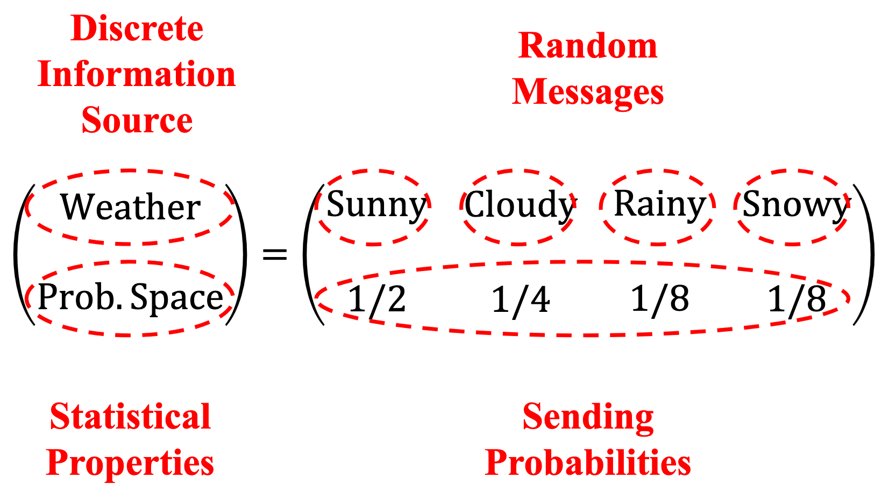
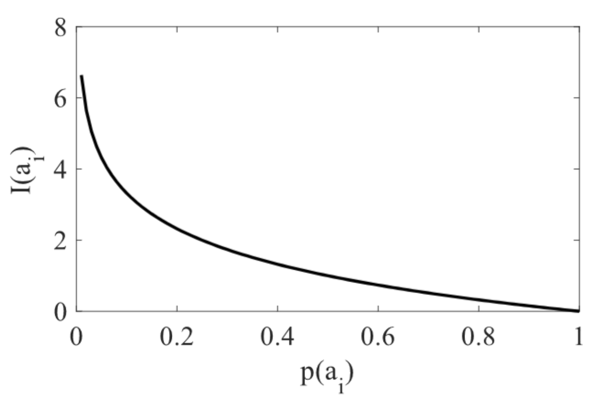

# 2 Discrete Information Source and Self-Information

<LyricCover
  image="IT-Lecture-2.attachments/1783151674756.jpg"
  title="過去を喰らう"
  artist="花譜"
  lang="ja"
>
  <LyricLine
    original="夢(ゆめ)や希望(きぼう)はなんだった？"
    translation="梦想和希望究竟是什么？"
  />
  <LyricLine
    original="やりたいことはこれだった？"
    translation="想做的事情就只有这些吗？"
  />
</LyricCover>

## 章节目录

- [章节目录](#章节目录)
- [2-1 离散信息源 Discrete Information Source](#2-1-离散信息源-discrete-information-source)
  - [2-1-1 信息源与离散信源](#2-1-1-信息源与离散信源)
  - [2-1-2 离散随机变量](#2-1-2-离散随机变量)
  - [2-1-3 信息量 Amount of Information](#2-1-3-信息量-amount-of-information)
- [2-2 消息的自信息 Self-information of Messages](#2-2-消息的自信息-self-information-of-messages)
  - [2-2-1 信息的测量与单位](#2-2-1-信息的测量与单位)
  - [2-2-2 自信息的简单例子 Simple Examples of Self-information](#2-2-2-自信息的简单例子-simple-examples-of-self-information)
- [2-3 自信息的性质 Properties of Self-information](#2-3-自信息的性质-properties-of-self-information)
- [2-4 联合自信息与条件自信息 Joint \& Conditional Self-information](#2-4-联合自信息与条件自信息-joint--conditional-self-information)
  - [2-4-1 联合自信息 Joint Self-information](#2-4-1-联合自信息-joint-self-information)
  - [2-4-2 条件自信息 Conditional Self-information](#2-4-2-条件自信息-conditional-self-information)

## 2-1 离散信息源 Discrete Information Source

### 2-1-1 信息源与离散信源

::: definition 信息源 Information Source

信息源，简称信源，负责发送 **消息 Message**。

不确定 / 随机的消息负责承载 **信息 Information**。

:::

一个信息源通常被建模成一个 **随机变量/向量 Random Variable/Vector**，而信息源所发送的消息就是该随机变量或随机向量的可能取值。

::: definition 离散信源 Discrete Information Source

离散信源仅发送**离散消息 Discrete Messages**，即消息的内容是有限的。因此通常把随机信源当做具有有限状态的随机序列来建模

:::

如果一个离散信息源只涉及单个随机事件，则可以看作**单符号信源 Single-symbol Source**；如果一个离散信源涉及多个随机事件，则可以看作**多符号信源 Multi-symbol Source**。

> [!NOTE]
>
> 信源样例：天气
>
> 
>

---

### 2-1-2 离散随机变量

#### 离散信源的数学模型

离散信源可以被建模成以下数学模型：

$$
\begin{bmatrix}
\text{离散信源} X \\
\text{概率空间} P(X)
\end{bmatrix}
=
\begin{bmatrix}
\text{消息} a_1 & \cdots & \text{消息} a_i & \cdots & \text{消息} a_n \\
\text{概率} p(a_1) & \cdots & \text{概率} p(a_i) & \cdots & \text{概率} p(a_n) \\
\end{bmatrix}
$$

- 信源发送消息，消息承载信息，信息是**随机和不确定的**；
- 概率约束： $0 \le p(a_i) \le 1 , \; \sum_{i=1}^n p(a_i) = 1$ 。

#### 离散随机变量

考虑如下随机变量 $X$ 和 $Y$ 的概率空间：

$$
\begin{bmatrix}
X \\
P(X)
\end{bmatrix}
=
\begin{bmatrix}
a_1 & \cdots & a_i & \cdots & a_n \\
p(a_1) & \cdots & p(a_i) & \cdots & p(a_n)
\end{bmatrix}
$$

$$
\begin{bmatrix}
Y \\
P(Y)
\end{bmatrix}
=
\begin{bmatrix}
b_1 & \cdots & b_i & \cdots & b_n \\
p(b_1) & \cdots & p(b_i) & \cdots & p(b_n)
\end{bmatrix}
$$

::: definition

**联合随机变量 Joint Random Variable** $XY \in \{ a_i b_j \vert i = 1,2, \cdots , n ; \; j = 1,2, \cdots , m\}$

- 其概率可被写作 $p(a_i b _j)$ ；
- 当 $X$ 和 $Y$ 相互独立时，联合概率为 $p(a_i b_j) = p(a_i)p(b_j)$ 。

**条件概率 Conditional Probability** 描述一对随机变量的**内在关系 Inherent Relationship**

- 给定 $X = a_i$ ，则 $Y = b_j$ 的概率为 $p(b_j | a_i)$ 。

**概率，条件概率和联合概率都满足一系列约束和性质。**

:::

---

### 2-1-3 信息量 Amount of Information

信息量刻画一条消息消除不确定性的程度。对单个消息而言，概率越低，发生后带来的信息量越高；概率越高，信息量越低。

用后续的自信息符号 $I(x)$ 表示：

$$
p(x)\uparrow \Rightarrow I(x)\downarrow,
\qquad
p(x)\downarrow \Rightarrow I(x)\uparrow.
$$

以 2018-2019 ECL 半决赛 Barcelona 对 Liverpool 为例。第一回合比分为 0-0 时，可把晋级结果看作离散信源 $X$：

| 消息 | Odds | 概率 | 信息量判断 |
| --- | --- | --- | --- |
| $x_1$：Barcelona 晋级 | 1.65/1 | $p(x_1)=58.5\%$ | regular news, moderate information |
| $x_2$：Liverpool 晋级 | 2.33/1 | $p(x_2)=41.5\%$ | regular news, moderate information |

两个结果的概率没有明显偏向，任一消息发生时都只消除中等程度的不确定性。

第二回合开始前，Liverpool 已经以 0-3 落后。此时离散信源 $Y$ 的概率分布更极端：

| 消息 | Odds | 概率 | 信息量判断 |
| --- | --- | --- | --- |
| $y_1$：Barcelona 晋级 | 1/50 | $p(y_1)=99.9\%$ | expected, regular news, low information |
| $y_2$：Liverpool 晋级 | 18/1 | $p(y_2)=0.1\%$ | unexpected, breaking news, very high information |

Barcelona 晋级接近必然事件，消息发生后消除的不确定性很少。Liverpool 晋级是小概率事件，若发生，则对应很高的信息量。

## 2-2 消息的自信息 Self-information of Messages

### 2-2-1 信息的测量与单位

投掷一枚硬币正反面的概率密度为：

$$
\begin{bmatrix}
X \\
P(X)
\end{bmatrix}
=
\begin{bmatrix}
Head & Tail \\
0.5 & 0.5
\end{bmatrix}
$$

- 总状态数 $2 = 2^1$
- 消息携带的信息 $1 = \log_2 2 = - \log_2 \frac{1}{2}$

对于两枚硬币，其概率空间为：

$$
\begin{bmatrix}
X \\
P(X)
\end{bmatrix}
=
\begin{bmatrix}
Head/Head & Head/Tail & Tail/Head & Tail/Tail \\
0.25 & 0.25 & 0.25 & 0.25
\end{bmatrix}
$$

- 总状态数 $4 = 2^2$
- 消息携带的信息 $2 = \log_2 4 = -\log_2 \frac{1}{4}$

::: definition 自信息 Self-information
记作 $I(a_i)$ ，用于描述消息所携带的信息量。

$$
\begin{bmatrix}
X \\ P(X) \\ I(X)
\end{bmatrix}
=
\begin{bmatrix}
a_1 & \cdots & a_i & \cdots & a_n \\
p(a_1) & \cdots & p(a_i) & \cdots & p(a_n) \\
I(a_1) & \cdots & I(a_i) & \cdots & I(a_n)
\end{bmatrix}
$$

其中

$$
I(a_i) = -\log_2 p(a_i) \qquad (\text{bits})
$$

对数前的符号意味着越小概率的消息携带着更大的信息量。

:::

自信息的单位与对数的底数有关：

- 当底数为 $2$ ，信息量单位为 $\text{bit}$ ；
- 当底数为 $e$ ，信息量单位为 $\text{nat}$ ；
- 当底数为 $10$ ，信息量单位为 $\text{det}$ 或 $\text{hart}$ 。

---

### 2-2-2 自信息的简单例子 Simple Examples of Self-information

沿用 2-1-3 中 Barcelona 与 Liverpool 的晋级新闻例子。由自信息定义，代入各消息概率可得：

$$
\begin{aligned}
I(x_1) &= -\log_2(0.585) = 0.773\ \mathrm{bit}, \\
I(x_2) &= -\log_2(0.415) = 1.269\ \mathrm{bit}, \\
I(y_1) &= -\log_2(0.999) = 0.0014\ \mathrm{bit}, \\
I(y_2) &= -\log_2(0.001) = 9.9658\ \mathrm{bit}.
\end{aligned}
$$

第一回合比分为 0-0 时，两个晋级消息的概率没有拉开极端差距：

| 消息 | 概率 | 自信息 | 信息量判断 |
| --- | --- | --- | --- |
| $x_1$：Barcelona 晋级 | $58.5\%$ | $0.773\ \mathrm{bit}$ | regular news, moderate information |
| $x_2$：Liverpool 晋级 | $41.5\%$ | $1.269\ \mathrm{bit}$ | regular news, moderate information |

第二回合 Liverpool 已经以 0-3 落后时，两个晋级消息的概率差距很大：

| 消息 | 概率 | 自信息 | 信息量判断 |
| --- | --- | --- | --- |
| $y_1$：Barcelona 晋级 | $99.9\%$ | $0.0014\ \mathrm{bit}$ | expected, regular news, low information |
| $y_2$：Liverpool 晋级 | $0.1\%$ | $9.9658\ \mathrm{bit}$ | unexpected, breaking news, very high information |

$p(y_1)$ 接近 $1$，所以 $I(y_1)$ 接近 $0$。$p(y_2)$ 极小，发生后对应很高的自信息。

## 2-3 自信息的性质 Properties of Self-information

> [!IMPORTANT]
>
> 自信息的性质可以归总为以下四点：
>
> - 非负 Non-negative
> - 单调递减 Monotonously Decreasing
> - 若 $p(a_i) = 1$ ，则 $I(a_i) = 0$
> - 若 $p(a_i) = 0$ ，则 $I(a_i) = \infty$

如果一个消息出现的概率很高，那它就含有更低的信息和不确定性，反之亦然。

**自信息 $I(a_i)$ 是一个关于 $a_i$ 的函数，量化了消息 $a_i$ 传达的信息总量。**

## 2-4 联合自信息与条件自信息 Joint & Conditional Self-information

### 2-4-1 联合自信息 Joint Self-information

对两个随机事件 $X$ 与 $Y$，联合消息记作 $a_i b_j$。对应的离散联合信源为：

$$
XY \in \{a_i b_j \mid i = 1,2,\cdots,n;\ j = 1,2,\cdots,m\}
$$

其联合概率满足：

$$
0 \le p(a_i b_j) \le 1,
\qquad
\sum_{i=1}^{n}\sum_{j=1}^{m}p(a_i b_j)=1.
$$

::: definition 联合自信息 Joint Self-information

联合消息 $a_i b_j$ 的自信息定义为联合概率的负二进制对数：

$$
I(a_i b_j)=-\log_2 p(a_i b_j)
$$

:::

若 $X$ 与 $Y$ 相互独立，则有：

$$
p(a_i b_j)=p(a_i)p(b_j)
$$

因此：

$$
\begin{aligned}
I(a_i b_j)
&= -\log_2[p(a_i)p(b_j)] \\
&= -\log_2 p(a_i)-\log_2 p(b_j) \\
&= I(a_i)+I(b_j).
\end{aligned}
$$

---

### 2-4-2 条件自信息 Conditional Self-information

条件自信息描述给定一个消息后，另一个消息仍然带来的信息量。

::: definition 条件自信息 Conditional Self-information

给定 $b_j$ 时，$a_i$ 发生的条件自信息为：

$$
I(a_i \mid b_j)=-\log_2 p(a_i \mid b_j)
$$

给定 $a_i$ 时，$b_j$ 发生的条件自信息为：

$$
I(b_j \mid a_i)=-\log_2 p(b_j \mid a_i)
$$

:::

由条件概率可得联合概率的两种分解：

$$
p(a_i b_j)=p(a_i)p(b_j \mid a_i)=p(b_j)p(a_i \mid b_j)
$$

代入联合自信息：

$$
\begin{aligned}
I(a_i b_j)
&= -\log_2[p(a_i)p(b_j \mid a_i)] \\
&= I(a_i)+I(b_j \mid a_i) \\
&= -\log_2[p(b_j)p(a_i \mid b_j)] \\
&= I(b_j)+I(a_i \mid b_j).
\end{aligned}
$$

:::: stem IT2-E1

2018-2019 ECL 半决赛中，Barcelona 与 Liverpool 的晋级消息概率如下：

| 场景 | 消息 | 概率 |
| --- | --- | --- |
| 第一回合 0-0 | $x_1$：Barcelona 晋级 | $p(x_1)=58.5\%$ |
| 第一回合 0-0 | $x_2$：Liverpool 晋级 | $p(x_2)=41.5\%$ |
| 第二回合 Liverpool 0-3 落后 | $y_1$：Barcelona 晋级 | $p(y_1)=99.9\%$ |
| 第二回合 Liverpool 0-3 落后 | $y_2$：Liverpool 晋级 | $p(y_2)=0.1\%$ |

求四条消息各自的自信息，并判断哪条消息的信息量最高。

::::

:::: solution

自信息定义为：

$$
I(x)=-\log_2 p(x)
$$

代入四个概率：

$$
\begin{aligned}
I(x_1)
&= -\log_2(0.585)
=0.773\ \mathrm{bit},\\
I(x_2)
&= -\log_2(0.415)
=1.269\ \mathrm{bit},\\
I(y_1)
&= -\log_2(0.999)
=0.0014\ \mathrm{bit},\\
I(y_2)
&= -\log_2(0.001)
=9.9658\ \mathrm{bit}.
\end{aligned}
$$

整理成表格：

| 消息 | 自信息 | 信息量判断 |
| --- | --- | --- |
| $x_1$ | $0.773\ \mathrm{bit}$ | regular news, moderate information |
| $x_2$ | $1.269\ \mathrm{bit}$ | regular news, moderate information |
| $y_1$ | $0.0014\ \mathrm{bit}$ | expected news, low information |
| $y_2$ | $9.9658\ \mathrm{bit}$ | breaking news, very high information |

$y_2$ 的概率最低，所以自信息最大。Liverpool 在第二回合逆转晋级对应最高信息量。

::::
