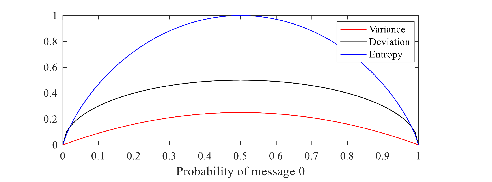
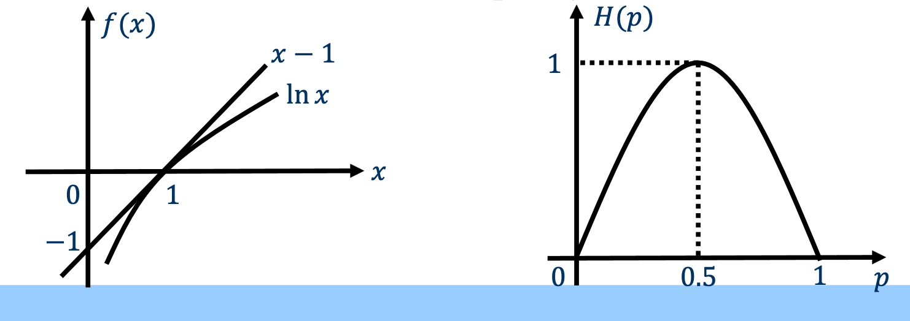
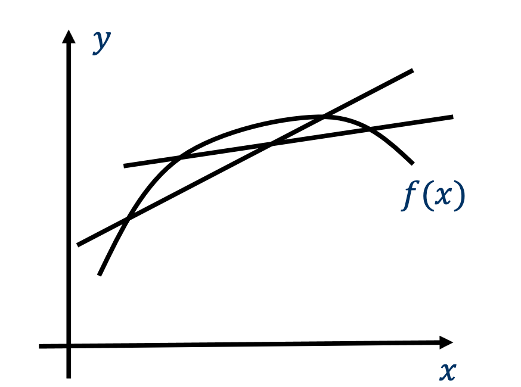

# 3 Entropy of Discrete Information Source

<LyricCover
  image="IT-Lecture-3.attachments/1783163738325.jpg"
  title="Virtual Insanity"
  artist="Jamiroquai"
  lang="en"
>
  <LyricLine
    original="Now always seem to be govern'd by this love we have, "
    translation="现在看来 我们的爱似乎都取决于，"
  />
  <LyricLine
    original="For useless twisting our new technology, "
    translation="奇技淫巧的高科技，"
  />
  <LyricLine
    original="Oh, now there is no sound for we all live underground."
    translation="噢 甚至没一个声音说出我们一直都活在阴暗里。"
  />
</LyricCover>

## 章节目录

- [章节目录](#章节目录)
- [3-1 熵 Entropy](#3-1-熵-entropy)
  - [3-1-1 离散信源的熵](#3-1-1-离散信源的熵)
  - [3-1-2 熵的三大物理意义](#3-1-2-熵的三大物理意义)
- [3-2 条件熵与联合熵 Conditional \& Joint Entropy](#3-2-条件熵与联合熵-conditional--joint-entropy)
  - [3-2-2 联合熵 Joint Entropy](#3-2-2-联合熵-joint-entropy)
  - [3-2-2 条件熵 Conditional Entropy](#3-2-2-条件熵-conditional-entropy)
- [3-3 熵的性质 Properties of Entropy](#3-3-熵的性质-properties-of-entropy)
  - [3-3-1 非负性、对称性与确定性 Non-negative, Symmetric, Certainty](#3-3-1-非负性对称性与确定性-non-negative-symmetric-certainty)
  - [3-3-2 离散信源熵 Entropy of Discrete Info. Source](#3-3-2-离散信源熵-entropy-of-discrete-info-source)
  - [3-3-3 离散信源的最大熵 Maximum Entropy of Discrete Source](#3-3-3-离散信源的最大熵-maximum-entropy-of-discrete-source)
  - [3-3-4 熵的可扩展性 The Entropy is Extendable](#3-3-4-熵的可扩展性-the-entropy-is-extendable)
  - [3-3-5 熵的可加性 The Entropy is Additive](#3-3-5-熵的可加性-the-entropy-is-additive)
  - [3-3-6 熵的极值 Extremum of the Entropy](#3-3-6-熵的极值-extremum-of-the-entropy)
  - [3-3-7 熵的凹性与凸性 Concavity and Convexity of the Entropy](#3-3-7-熵的凹性与凸性-concavity-and-convexity-of-the-entropy)
  - [3-3-8 例题 Examples](#3-3-8-例题-examples)

## 3-1 熵 Entropy

### 3-1-1 离散信源的熵

对于一个离散信源：

$$
\begin{bmatrix}
X \\ P(X) \\ I(X)
\end{bmatrix}
=
\begin{bmatrix}
a_1 & \cdots & a_i & \cdots & a_n \\
p(a_1) & \cdots & p(a_i) & \cdots & p(a_n) \\
I(a_1) & \cdots & I(a_i) & \cdots & I(a_n)
\end{bmatrix}
$$

我们有如下定义：

::: definition 熵 Entropy
对一个信源的所有可能的消息，其**平均自信息 Average Self-information** 被称为 **熵 Entropy**，记作 $H(X)$。

对离散信源，其数学形式写作：

$$
H(X) = \sum_{i=1}^n p(a_i) \cdot I(a_i) = - \sum_{i=1}^{n} p(a_i) \log_2 p(a_i)
$$

:::

:::: stem IT3-E1

计算以下离散信源的熵。

1. Football game

第一回合比分为 Barcelona (0) vs Liverpool (0)，晋级概率为：

| 消息 | 概率 |
| --- | --- |
| Barcelona 晋级 | $58.5\%$ |
| Liverpool 晋级 | $41.5\%$ |

第二回合开始前，比分为 Liverpool (0) vs Barcelona (3)，晋级概率为：

| 消息 | 概率 |
| --- | --- |
| Barcelona 晋级 | $99.9\%$ |
| Liverpool 晋级 | $0.1\%$ |

2. Weather

天气信源的概率空间为：

$$
\begin{bmatrix}
W \\
P(W)
\end{bmatrix}
=
\begin{bmatrix}
\text{Sunny} & \text{Cloudy} & \text{Rainy} & \text{Snowy} \\
\frac{1}{2} & \frac{1}{4} & \frac{1}{8} & \frac{1}{8}
\end{bmatrix}
$$

::::

:::: solution

由熵的定义：

$$
H(X)=-\sum_i p(a_i)\log_2 p(a_i)
$$

对第一回合 football game 信源 $X$：

$$
\begin{aligned}
H(X)
&= -0.585\log_2 0.585 - 0.415\log_2 0.415 \\
&= 0.9791\ \mathrm{bit/sign}.
\end{aligned}
$$

对第二回合 football game 信源 $Y$：

$$
\begin{aligned}
H(Y)
&= -0.999\log_2 0.999 - 0.001\log_2 0.001 \\
&= 0.0114\ \mathrm{bit/sign}.
\end{aligned}
$$

对 weather 信源 $W$：

$$
\begin{aligned}
H(W)
&= -\frac{1}{2}\log_2\frac{1}{2}
   -\frac{1}{4}\log_2\frac{1}{4}
   -\frac{1}{8}\log_2\frac{1}{8}
   -\frac{1}{8}\log_2\frac{1}{8} \\
&= 1.75\ \mathrm{bit/sign}.
\end{aligned}
$$

$Y$ 的概率几乎集中在 Barcelona 晋级上，因此熵最低。Weather 信源有四个可能天气，且概率分布更分散，因此平均不确定性更高。

::::

---

### 3-1-2 熵的三大物理意义

熵刻画了：

- 每个消息携带的平均自信息；
- 信源的**平均不确定度 Average Uncertainty**；
- 随机变量的随机程度，在这一点上的性质与方差和标准差类似。

## 3-2 条件熵与联合熵 Conditional & Joint Entropy

### 3-2-2 联合熵 Joint Entropy

对于联合离散信源 $XY$ ，其数学模型如下：

$$
\begin{aligned}
\begin{bmatrix}
XY \\
P(XY)
\end{bmatrix}
&= \\ &\quad
\begin{bmatrix}
a_1b_1 & \cdots & a_1b_m & a_2b_1 & \cdots & a_2b_m & \cdots & a_nb_1 & \cdots & a_nb_m \\
p(a_1b_1) & \cdots & p(a_1b_m) & p(a_2b_1) & \cdots & p(a_2b_m) & \cdots & p(a_nb_1) & \cdots & p(a_nb_m)
\end{bmatrix}
\end{aligned}
$$

::: definition 联合熵 Joint Entropy
其定义为每个联合消息所携带的信息的数学期望，发送自联合信源 $XY$ ：

$$
\begin{aligned}
H(XY)
&=
E[I(a_i b_j)] \\
&=
\sum_{j=1}^{m}\sum_{i=1}^{n} p(a_i b_j) I(a_i b_j) \\
&=
-\sum_{j=1}^{m}\sum_{i=1}^{n}
p(a_i b_j)\log_2 p(a_i b_j)
\end{aligned}
$$

:::

---

### 3-2-2 条件熵 Conditional Entropy

对于联合离散信源 $XY$ ：

$$
\begin{aligned}
\begin{bmatrix}
XY \\
P(XY)
\end{bmatrix}
&= \\ &
\begin{bmatrix}
a_1b_1 & \cdots & a_1b_m & a_2b_1 & \cdots & a_2b_m & \cdots & a_nb_1 & \cdots & a_nb_m \\
p(a_1b_1) & \cdots & p(a_1b_m) & p(a_2b_1) & \cdots & p(a_2b_m) & \cdots & p(a_nb_1) & \cdots & p(a_nb_m)
\end{bmatrix}
\end{aligned}
$$

::: definition 条件熵 Conditional Entropy
给定信息接收端 $Y$ ，条件熵 $H(X|Y)$ 可被表示为：

$$
\begin{aligned}
H(X|Y) \\
&=
E[I(a_i|b_j)] \\
&=
\sum_{j=1}^{m}\sum_{i=1}^{n}
p(a_i b_j)I(a_i|b_j) \\
&=
-\sum_{j=1}^{m}\sum_{i=1}^{n}
p(a_i b_j)\log_2 p(a_i b_j) \\

\end{aligned}
$$

:::

在实际中，通过一个信道接收到的信息记作 Y ，如果记发射出去的信息为 X，则条件熵可以用来描述通过 Y 判断 X 的准确程度。因此：

条件熵又被称作 **信道疑义度 Channel Equivocation** 或 **损失熵 Loss Entropy**。

## 3-3 熵的性质 Properties of Entropy

### 3-3-1 非负性、对称性与确定性 Non-negative, Symmetric, Certainty

#### 1. 非负性

**非负性 Non-negative**：信源的熵是所有可能消息携带信息量的数学期望。由于自信息非负，熵也非负。

#### 2. 对称性

**对称性 Symmetric**：在计算中改变消息概率的排列顺序，不会改变熵的值。

$$
H(X)
=H[p(a_1),\cdots,p(a_n)]
=-\sum_{i=1}^{n}p(a_i)\log_2 p(a_i)
$$

熵只依赖信源的整体统计特性，不依赖某个具体消息的名称，也不依赖消息本身的具体取值。

#### 3. 确定性

**确定性 Certainty**：若信源产生某个消息的概率为 $1$，则该信源的熵为 $0$。此时信源是确定信源，其不确定性为 $0$。

$$
H(1,0)
=H(1,0,\cdots,0)
=H(0,1,\cdots,0)
=\cdots
=0.
$$

---

### 3-3-2 离散信源熵 Entropy of Discrete Info. Source

离散信源的输出可以是硬币、骰子、比赛结果等有限个随机消息。熵用于量化该信源本身产生信息的平均能力。

对于一个离散信源 $X$：

$$
X=\{a_1,a_2,\cdots,a_n\},
\qquad
P(X)=\{p(a_1),p(a_2),\cdots,p(a_n)\}.
$$

其熵为：

$$
H(X)=-\sum_{i=1}^{n}p(a_i)\log_2 p(a_i).
$$

---

### 3-3-3 离散信源的最大熵 Maximum Entropy of Discrete Source

::: definition 离散信源最大熵 Maximum Entropy of Discrete Source
若信息源 $X$ 可以产生 $n$ 个可能消息，则其熵满足：

$$
H(X)\le \log_2 n
$$

当 $n$ 个消息以相等概率产生时，等号成立。
:::

证明中可使用自然对数性质：

$$
\ln{x}\le x-1,
\qquad
x>0.
$$

当 $x=1$ 时，上式取等号。对应到信源概率分布时，即所有消息等概率：

$$
p(a_1)=p(a_2)=\cdots=p(a_n)=\frac{1}{n}.
$$

此时熵达到最大值：

$$
H(X)=\log_2 n.
$$

---

### 3-3-4 熵的可扩展性 The Entropy is Extendable

设信息源 $X$ 可以产生 $n$ 个可能消息，另一个信息源 $Y$ 可以产生 $n+1$ 个消息。若 $Y$ 中新增消息的概率趋近于 $0$，其余消息的概率几乎与 $X$ 相同，则 $Y$ 的熵与 $X$ 的熵相同。

该性质写作：

$$
\lim_{\epsilon\to 0}
H_{n+1}[p(a_1),\cdots,p(a_n)-\epsilon,p(a_{n+1})=\epsilon]
=
H_n[p(a_1),\cdots,p(a_n)].
$$

该式成立的原因是：

$$
\lim_{\epsilon\to 0}\epsilon\log_2\epsilon=0.
$$

虽然小概率消息携带较高自信息，但它对信源熵的贡献较小。

若新增 $s$ 个概率趋近于 $0$ 的消息，类似的可扩展性质仍然成立。

---

### 3-3-5 熵的可加性 The Entropy is Additive

给定两个随机信息源 $X$ 与 $Y$，联合熵、单独熵和条件熵满足：

$$
H(XY)=H(X)+H(Y|X)
$$

$$
H(XY)=H(Y)+H(X|Y)
$$

这是熵的可加性。证明时直接利用熵、条件熵、联合熵的定义，以及随机变量的概率关系。

当信息源 $X$ 与 $Y$ 相互独立时：

$$
H(XY)=H(X)+H(Y).
$$

---

### 3-3-6 熵的极值 Extremum of the Entropy

对于任意一对随机信息源 $X$ 与 $Y$，有如下不等式：

$$
H_n[p(a_1),\cdots,p(a_n)]
=-\sum_{i=1}^{n}p(a_i)\log_2 p(a_i)
\le
-\sum_{i=1}^{n}p(a_i)\log_2 p(b_i).
$$

对于任意概率分布 $\{p(a_i)\}$，若取另一个概率分布 $\{p(b_i)\}$ 的自信息并按 $\{p(a_i)\}$ 加权平均，所得值高于或等于其自身熵。

利用熵的极值性质，可以证明条件熵低于无条件熵：

$$
H(X|Y)\le H(X).
$$

---

### 3-3-7 熵的凹性与凸性 Concavity and Convexity of the Entropy

对于多变量函数：

$$
f(a_1,\cdots,a_n)=f(\mathbf X)
$$

给定任意正数 $\alpha$ 和定义域中的一对向量 $\mathbf X$、$\mathbf Y$，若有：

$$
f[\alpha\mathbf X+(1-\alpha)\mathbf Y]
\ge
\alpha f(\mathbf X)+(1-\alpha)f(\mathbf Y),
$$

则 $f(\mathbf X)$ 是凹函数。

熵是一个凹函数。给定一对概率向量：

$$
P=[p(a_1),\cdots,p(a_n)],
\qquad
Q=[p(b_1),\cdots,p(b_n)].
$$

其中：

$$
0\le p(a_i)\le 1,
\qquad
0\le p(b_i)\le 1,
$$

且：

$$
\sum_{i=1}^{n}p(a_i)
=
\sum_{i=1}^{n}p(b_i)
=1.
$$

对于任意正数 $\alpha$，有：

$$
H[\alpha P+(1-\alpha)Q]
\ge
\alpha H(P)+(1-\alpha)H(Q).
$$

课件中也用凸性方法证明离散信源最大熵：

$$
H(X)\le \log_2 n.
$$

这里按标准说法应理解为：熵函数本身是凹函数，$-H(X)$ 是凸函数。利用极值性质或拉格朗日乘子法，都可以得到最大熵出现在等概率分布处。

---

### 3-3-8 例题 Examples

:::: stem IT3-E2
设 $g(X)$ 是随机变量 $X$ 的函数。证明：

$$
H[g(X)]\le H(X).
$$

::::

:::: solution
由于 $g(X)$ 由 $X$ 决定，先有：

$$
H[X,g(X)]=H(X)+H[g(X)|X].
$$

其中：

$$
H[g(X)|X]=0
$$

于是：

$$
H[X,g(X)]=H(X).
$$

另一方面，由联合熵可加性：

$$
H[X,g(X)]
=H[g(X)]+H[X|g(X)]
\ge H[g(X)].
$$

因此：

$$
H[g(X)]\le H(X).
$$

::::

:::: stem IT3-E3
假设随机变量 $X$ 与 $Y$ 的联合概率由下表给出：

| $X$ | $Y=0$ | $Y=1$ |
| --- | --- | --- |
| $0$ | $\frac{1}{3}$ | $\frac{1}{3}$ |
| $1$ | $0$ | $\frac{1}{3}$ |

计算：

$$
H(X),\ H(Y),\ H(X|Y),\ H(Y|X),\ H(X,Y),
$$

$$
H(X)-H(X|Y),
\qquad
H(Y)-H(Y|X).
$$

::::

:::: stem IT3-E4
比较两场足球比赛对应离散信源的信息价值。

1. 2018 World Cup Group H: Germany vs Korea

| 结果 | 概率 |
| --- | --- |
| Germany wins | $81.3\%$ |
| Draw | $13\%$ |
| Korea wins | $5.7\%$ |

2. 2018 World Cup Final (90 mins): France vs Croatia

| 结果 | 概率 |
| --- | --- |
| France wins | $50\%$ |
| Draw | $29\%$ |
| Croatia wins | $21\%$ |

哪一场比赛生成更有价值的信息？

::::

:::: solution
对 Germany vs Korea：

$$
\begin{aligned}
H(X)
&=
-0.813\log_2 0.813
-0.13\log_2 0.13
-0.057\log_2 0.057 \\
&=0.86\ \mathrm{bit}.
\end{aligned}
$$

对 France vs Croatia：

$$
\begin{aligned}
H(Y)
&=
-0.50\log_2 0.50
-0.29\log_2 0.29
-0.21\log_2 0.21 \\
&=1.50\ \mathrm{bit}.
\end{aligned}
$$

France vs Croatia 的结果分布更均匀，因此熵更高。它对应的信源平均不确定性更高，也更需要被量化。

::::
