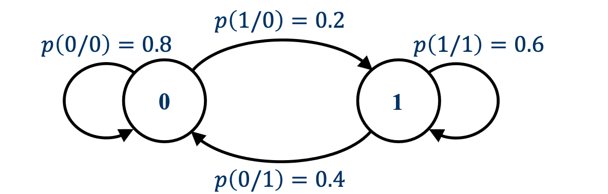
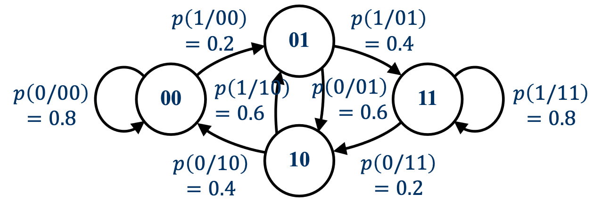
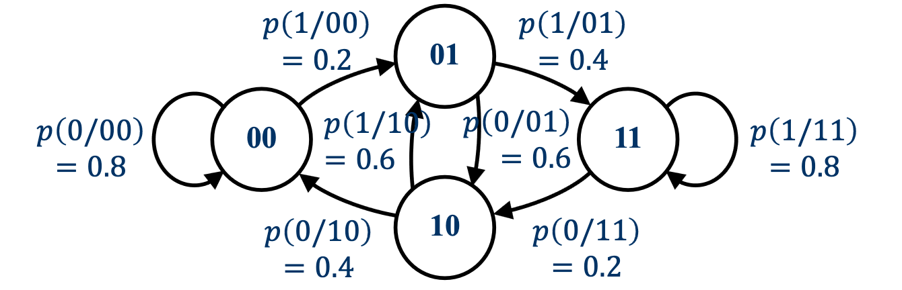
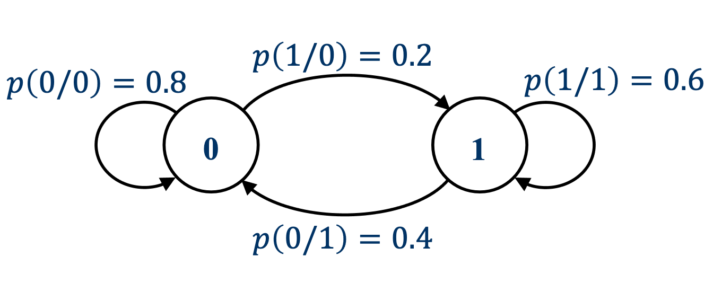
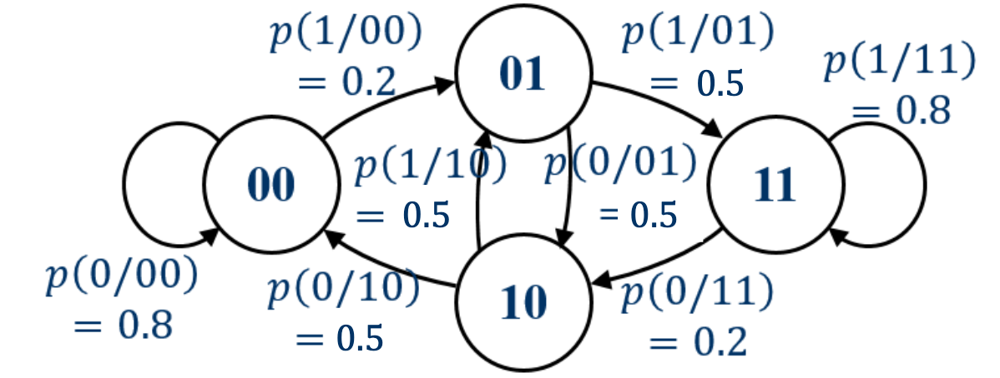

# 5 Markov Source and Redundancy

<LyricCover
  image="IT-Lecture-5.attachments/1783163799412.jpg"
  title="ゴースト警告を唄う"
  artist="Empty old City"
  lang="ja"
>
  <LyricLine
    original="Always I’m humming. humming. humming."
    translation="我一直低吟，低吟，低吟着，"
  />
  <LyricLine
    original="Can you hear me calling. calling. calling? "
    translation="你能听见我的呼唤，呼唤，呼唤吗？"
  />
</LyricCover>

## 章节目录

- [章节目录](#章节目录)
- [5-1 Markov 信源定义 Definition of Markov Source](#5-1-markov-信源定义-definition-of-markov-source)
  - [5-1-1 有限齐次 Markov 链 Finite Homogeneous Markov Chain](#5-1-1-有限齐次-markov-链-finite-homogeneous-markov-chain)
  - [5-1-2 N 维近似与有限记忆 N-D Approximation and Limited Memory](#5-1-2-n-维近似与有限记忆-n-d-approximation-and-limited-memory)
  - [5-1-3 Markov 信源的状态 State of Markov Source](#5-1-3-markov-信源的状态-state-of-markov-source)
  - [5-1-4 状态转移 State Transition](#5-1-4-状态转移-state-transition)
  - [5-1-5 状态转移图例题 State Transition Graph Examples](#5-1-5-状态转移图例题-state-transition-graph-examples)
- [5-2 Markov 信源模型 Model of Markov Source](#5-2-markov-信源模型-model-of-markov-source)
  - [5-2-1 状态转移矩阵 State Transition Matrix](#5-2-1-状态转移矩阵-state-transition-matrix)
  - [5-2-2 平稳分布 Stationary Distribution](#5-2-2-平稳分布-stationary-distribution)
  - [5-2-3 二阶 Markov 信源矩阵例题 Matrix Example](#5-2-3-二阶-markov-信源矩阵例题-matrix-example)
- [5-3 熵率计算 Calculation of Entropy Rate](#5-3-熵率计算-calculation-of-entropy-rate)
  - [5-3-1 Markov 信源的熵率 Entropy Rate of Markov Source](#5-3-1-markov-信源的熵率-entropy-rate-of-markov-source)
  - [5-3-2 一阶 Markov 信源熵率例题 First-Order Example](#5-3-2-一阶-markov-信源熵率例题-first-order-example)
  - [5-3-3 二阶 Markov 信源熵率例题 Second-Order Example](#5-3-3-二阶-markov-信源熵率例题-second-order-example)
  - [5-3-4 熵率计算流程 Calculation Steps](#5-3-4-熵率计算流程-calculation-steps)
- [5-4 信息源冗余 Redundancy of Information Source](#5-4-信息源冗余-redundancy-of-information-source)
  - [5-4-1 实际信源建模 Modelling a Practical Source](#5-4-1-实际信源建模-modelling-a-practical-source)
  - [5-4-2 英文信源熵率 English Language Entropy](#5-4-2-英文信源熵率-english-language-entropy)
  - [5-4-3 冗余度 Redundancy](#5-4-3-冗余度-redundancy)
  - [5-4-4 冗余度意义 Meaning of Redundancy](#5-4-4-冗余度意义-meaning-of-redundancy)

## 5-1 Markov 信源定义 Definition of Markov Source

### 5-1-1 有限齐次 Markov 链 Finite Homogeneous Markov Chain

::: definition Markov 性质 Markov Property
若下一状态的概率只由当前状态决定，而与更早的历史状态无关，则称该随机过程满足 **Markov 性质 Markov Property**。
:::

设状态序列为：

$$
\mathbf{s}
=
\begin{bmatrix}
s_1 & s_2 & \cdots & s_l & \cdots
\end{bmatrix}
$$

信源输出的符号序列为：

$$
\mathbf{u}
=
\begin{bmatrix}
u_1 & u_2 & \cdots & u_l & \cdots
\end{bmatrix}
$$

若状态集合有限，记为 $\{1,2,\cdots,J\}$，则从状态 $j$ 转移到状态 $i$ 的概率为：

$$
Q_{ij}
=
\Pr(s_l=i\mid s_{l-1}=j).
$$

Markov 性质写作：

$$
\Pr(s_l\mid s_{l-1},s_{l-2},\cdots)
=
\Pr(s_l\mid s_{l-1}).
$$

若转移概率 $Q_{ij}$ 不随时间 $l$ 改变，则状态序列构成**有限齐次 Markov 链 Finite Homogeneous Markov Chain**。

---

### 5-1-2 N 维近似与有限记忆 N-D Approximation and Limited Memory

$N$ 维离散平稳有记忆信源可以近似描述实际离散平稳信源。实际信源中，符号之间的统计相关性可能跨越很长的序列，有限维模型只能保留一部分相关性。

设离散信源从符号集合

$$
\mathcal X=\{a_1,a_2,a_3,a_4,a_5\}
$$

中随机产生序列：

$$
\mathbf X
=
\begin{bmatrix}
a_3 & a_5 & a_1 & a_3 & a_5 & a_2 & a_4 & a_1 & \cdots
\end{bmatrix}.
$$

若采用二维近似，只考虑相邻两个符号构成的消息；若采用三维近似，只考虑相邻三个符号构成的消息。维数越高，保留下来的符号相关性越多。

::: definition 有限记忆 Limited Memory
若某一时刻发送的符号只与之前有限个符号相关，而与更早发送的符号无关，则该信源具有有限记忆。
:::

当当前符号只与之前 $m$ 个符号相关时，称该信源的**记忆长度 Memory Length** 为 $m$。具有记忆长度 $m$ 的离散平稳信源称为 $m$ 阶 Markov 信源。

---

### 5-1-3 Markov 信源的状态 State of Markov Source

设 Markov 信源的字母表为：

$$
\mathcal X=\{a_1,a_2,\cdots,a_n\}.
$$

若记忆长度为 $m$，则当前符号只与之前 $m$ 个符号有关。把这 $m$ 个历史符号作为信源的**状态 State**：

$$
s_i
=
\begin{bmatrix}
a_{k_1} & a_{k_2} & \cdots & a_{k_m}
\end{bmatrix},
\qquad
i=1,2,\cdots,n^m.
$$

其中：

- $a_{k_1},a_{k_2},\cdots,a_{k_m}\in\{a_1,a_2,\cdots,a_n\}$；
- 状态总数为 $n^m$。

在下一时刻，信源发送新符号 $a_{k_{m+1}}$，历史窗口向前移动一位：

$$
\begin{bmatrix}
a_{k_1} & a_{k_2} & \cdots & a_{k_m} & a_{k_{m+1}}
\end{bmatrix}.
$$

于是下一状态为：

$$
s_j
=
\begin{bmatrix}
a_{k_2} & \cdots & a_{k_m} & a_{k_{m+1}}
\end{bmatrix},
\qquad
j=1,2,\cdots,n^m.
$$

状态从 $s_i$ 转移到 $s_j$。

---

### 5-1-4 状态转移 State Transition

Markov 信源的状态空间可写成：

$$
\begin{bmatrix}
S \\
P(S)
\end{bmatrix}
=
\begin{bmatrix}
s_1 & s_2 & \cdots & s_{n^m} \\
p(s_1) & p(s_2) & \cdots & p(s_{n^m})
\end{bmatrix},
\qquad
\sum_{i=1}^{n^m}p(s_i)=1.
$$

从状态 $s_i$ 转移到状态 $s_j$ 的概率为：

$$
p(s_j\mid s_i).
$$

状态转移由当前状态下发送的新符号决定。若

$$
s_i
=
\begin{bmatrix}
a_{k_1} & a_{k_2} & \cdots & a_{k_m}
\end{bmatrix},
\qquad
s_j
=
\begin{bmatrix}
a_{k_2} & \cdots & a_{k_m} & a_{k_{m+1}}
\end{bmatrix},
$$

则：

$$
p(s_j\mid s_i)
=
p(a_{k_{m+1}}\mid s_i).
$$

---

### 5-1-5 状态转移图例题 State Transition Graph Examples

:::: stem IT5-E1
给定一阶二元 Markov 信源，其符号发送概率为：

$$
p(0\mid 0)=0.8,
\qquad
p(1\mid 0)=0.2,
$$

$$
p(0\mid 1)=0.4,
\qquad
p(1\mid 1)=0.6.
$$

写出状态转移关系。
::::

:::: solution

该信源为一阶 Markov 信源，状态就是前一个符号：

$$
S=\{0,1\}.
$$

因此状态转移关系为：

$$
\begin{aligned}
0 &\to 0, &&p(0\mid 0)=0.8,\\
0 &\to 1, &&p(1\mid 0)=0.2,\\
1 &\to 0, &&p(0\mid 1)=0.4,\\
1 &\to 1, &&p(1\mid 1)=0.6.
\end{aligned}
$$

::::

:::: stem IT5-E2
给定二阶二元 Markov 信源，其符号发送概率为：

$$
\begin{aligned}
p(0\mid 00)&=0.8, & p(1\mid 00)&=0.2,\\
p(0\mid 01)&=0.6, & p(1\mid 01)&=0.4,\\
p(0\mid 10)&=0.4, & p(1\mid 10)&=0.6,\\
p(0\mid 11)&=0.2, & p(1\mid 11)&=0.8.
\end{aligned}
$$

写出状态转移关系。
::::

:::: solution

二阶二元 Markov 信源的状态由两个历史符号组成：

$$
S=\{00,01,10,11\}.
$$

发送新符号后，只保留最近两个符号。因此：

$$
\begin{aligned}
00 &\to 00, &&p(0\mid 00)=0.8,\\
00 &\to 01, &&p(1\mid 00)=0.2,\\
01 &\to 10, &&p(0\mid 01)=0.6,\\
01 &\to 11, &&p(1\mid 01)=0.4,\\
10 &\to 00, &&p(0\mid 10)=0.4,\\
10 &\to 01, &&p(1\mid 10)=0.6,\\
11 &\to 10, &&p(0\mid 11)=0.2,\\
11 &\to 11, &&p(1\mid 11)=0.8.
\end{aligned}
$$

::::

## 5-2 Markov 信源模型 Model of Markov Source

### 5-2-1 状态转移矩阵 State Transition Matrix

设状态集合为：

$$
S=\{s_1,s_2,\cdots,s_{n^m}\}.
$$

若采用列随机矩阵 Column-stochastic Matrix，状态转移矩阵定义为：

$$
\boldsymbol{\Lambda}
=
\begin{bmatrix}
p(s_1\mid s_1) & p(s_1\mid s_2) & \cdots & p(s_1\mid s_{n^m}) \\
p(s_2\mid s_1) & p(s_2\mid s_2) & \cdots & p(s_2\mid s_{n^m}) \\
\vdots & \vdots & \ddots & \vdots \\
p(s_{n^m}\mid s_1) & p(s_{n^m}\mid s_2) & \cdots & p(s_{n^m}\mid s_{n^m})
\end{bmatrix}.
$$

第 $j$ 列表示从状态 $s_j$ 出发，转移到各个状态的概率，因此每一列概率和为 $1$：

$$
\sum_{i=1}^{n^m}p(s_i\mid s_j)=1.
$$

实际计算例题时也常用行随机矩阵 Row-stochastic Matrix：

$$
\mathbf T
=
\begin{bmatrix}
p(s_1\mid s_1) & p(s_2\mid s_1) & \cdots & p(s_{n^m}\mid s_1) \\
p(s_1\mid s_2) & p(s_2\mid s_2) & \cdots & p(s_{n^m}\mid s_2) \\
\vdots & \vdots & \ddots & \vdots \\
p(s_1\mid s_{n^m}) & p(s_2\mid s_{n^m}) & \cdots & p(s_{n^m}\mid s_{n^m})
\end{bmatrix}.
$$

第 $i$ 行表示从状态 $s_i$ 出发，转移到各个状态的概率。

---

### 5-2-2 平稳分布 Stationary Distribution

若 Markov 信源齐次且达到平稳状态，则状态分布满足：

$$
p(s_j)
=
\sum_{i=1}^{n^m}p(s_i)p(s_j\mid s_i),
\qquad
j=1,2,\cdots,n^m.
$$

记平稳分布为列向量：

$$
\boldsymbol{\pi}
=
\begin{bmatrix}
p(s_1) \\
p(s_2) \\
\vdots \\
p(s_{n^m})
\end{bmatrix}.
$$

若使用列随机矩阵 $\boldsymbol{\Lambda}$，则：

$$
\boldsymbol{\Lambda}\boldsymbol{\pi}
=
\boldsymbol{\pi}.
$$

概率还需要满足：

$$
0\le p(s_j)\le 1,
\qquad
\sum_{j=1}^{n^m}p(s_j)=1.
$$

若使用行随机矩阵 $\mathbf T$，则把平稳分布写成行向量：

$$
\boldsymbol{\pi}^{\mathsf T}\mathbf T
=
\boldsymbol{\pi}^{\mathsf T}.
$$

两种写法只差矩阵方向，计算时不要混用。

---

### 5-2-3 二阶 Markov 信源矩阵例题 Matrix Example

:::: stem IT5-E3
给定二阶二元 Markov 信源，状态集合为：

$$
S=\{00,01,10,11\}.
$$

符号发送概率为：

$$
\begin{aligned}
p(0\mid 00)&=0.8, & p(1\mid 00)&=0.2,\\
p(0\mid 01)&=0.6, & p(1\mid 01)&=0.4,\\
p(0\mid 10)&=0.4, & p(1\mid 10)&=0.6,\\
p(0\mid 11)&=0.2, & p(1\mid 11)&=0.8.
\end{aligned}
$$

写出行随机状态转移矩阵。
::::

:::: solution

状态顺序取：

$$
\begin{bmatrix}
00 & 01 & 10 & 11
\end{bmatrix}.
$$

发送 $0$ 或 $1$ 后，窗口向前移动一位：

$$
\mathbf T
=
\begin{bmatrix}
0.8 & 0.2 & 0 & 0 \\
0 & 0 & 0.6 & 0.4 \\
0.4 & 0.6 & 0 & 0 \\
0 & 0 & 0.2 & 0.8
\end{bmatrix}.
$$

例如状态 $01$ 下发送 $0$ 后进入 $10$，发送 $1$ 后进入 $11$，因此第二行为：

$$
\begin{bmatrix}
0 & 0 & 0.6 & 0.4
\end{bmatrix}.
$$

::::

## 5-3 熵率计算 Calculation of Entropy Rate

### 5-3-1 Markov 信源的熵率 Entropy Rate of Markov Source

对一般 $N$ 维有记忆信源，符号相关性由联合概率描述。对 Markov 信源，相关性由状态转移概率描述。

若 Markov 信源的阶数为 $m$，则第 $m+1$ 个符号只与前 $m$ 个符号相关。其极限熵可写成：

$$
\begin{aligned}
H_\infty(\mathbf X)
&=
\lim_{N\to\infty}H(X_N\mid X_1X_2\cdots X_{N-1})\\
&=
H(X_{m+1}\mid X_1X_2\cdots X_m)\\
&=
H_{m+1}(\mathbf X).
\end{aligned}
$$

因此，$m$ 阶 Markov 信源的熵率等于同阶条件熵：

$$
\boxed{
H_\infty(\mathbf X)
=
H(X_{m+1}\mid X_1X_2\cdots X_m)
}
$$

利用状态表示，可进一步写成：

$$
\boxed{
H_\infty(\mathbf X)
=
-
\sum_{i=1}^{n^m}\sum_{j=1}^{n^m}
p(s_i)p(s_j\mid s_i)\log_2 p(s_j\mid s_i)
}
$$

其中 $\{p(s_i)\}$ 为 $m$ 阶 Markov 信源的平稳分布。

---

### 5-3-2 一阶 Markov 信源熵率例题 First-Order Example

:::: stem IT5-E4
给定一阶二元 Markov 信源：

$$
p(0\mid 0)=0.8,
\qquad
p(1\mid 0)=0.2,
$$

$$
p(0\mid 1)=0.4,
\qquad
p(1\mid 1)=0.6.
$$

计算该 Markov 信源的熵率。
::::

:::: solution
取状态集合：

$$
S=\{0,1\}.
$$

行随机转移矩阵为：

$$
\mathbf T
=
\begin{bmatrix}
0.8 & 0.2 \\
0.4 & 0.6
\end{bmatrix}.
$$

设平稳分布为：

$$
\boldsymbol{\pi}^{\mathsf T}
=
\begin{bmatrix}
q_0 & q_1
\end{bmatrix}.
$$

由 $\boldsymbol{\pi}^{\mathsf T}\mathbf T=\boldsymbol{\pi}^{\mathsf T}$ 与 $q_0+q_1=1$：

$$
\begin{cases}
0.8q_0+0.4q_1=q_0,\\
0.2q_0+0.6q_1=q_1,\\
q_0+q_1=1.
\end{cases}
$$

解得：

$$
q_0=\frac{2}{3},
\qquad
q_1=\frac{1}{3}.
$$

状态 $0$ 下发送新符号的条件熵为：

$$
\begin{aligned}
H(X\mid 0)
&=
-0.8\log_2 0.8-0.2\log_2 0.2\\
&=
0.7219\ \mathrm{bit/symbol}.
\end{aligned}
$$

状态 $1$ 下：

$$
\begin{aligned}
H(X\mid 1)
&=
-0.4\log_2 0.4-0.6\log_2 0.6\\
&=
0.9710\ \mathrm{bit/symbol}.
\end{aligned}
$$

因此：

$$
\begin{aligned}
H_\infty(\mathbf X)
&=
q_0H(X\mid 0)+q_1H(X\mid 1)\\
&=
\frac{2}{3}\times 0.7219+\frac{1}{3}\times 0.9710\\
&=
0.8049\ \mathrm{bit/symbol}.
\end{aligned}
$$

::::

---

### 5-3-3 二阶 Markov 信源熵率例题 Second-Order Example

:::: stem IT5-E5
给定二阶二元 Markov 信源。令：

$$
E_1=00,
\qquad
E_2=01,
\qquad
E_3=10,
\qquad
E_4=11.
$$

其符号发送概率矩阵为：

$$
p(a_j\mid E_i)
=
\begin{bmatrix}
0.8 & 0.2 \\
0.5 & 0.5 \\
0.5 & 0.5 \\
0.2 & 0.8
\end{bmatrix},
$$

其中列顺序为：

$$
\begin{bmatrix}
a_1(0) & a_2(1)
\end{bmatrix}.
$$

计算该信源的熵率。
::::

:::: solution
由符号发送概率得到行随机状态转移矩阵：

$$
\mathbf T
=
\begin{bmatrix}
0.8 & 0.2 & 0 & 0 \\
0 & 0 & 0.5 & 0.5 \\
0.5 & 0.5 & 0 & 0 \\
0 & 0 & 0.2 & 0.8
\end{bmatrix}.
$$

设平稳分布为：

$$
\boldsymbol{\pi}^{\mathsf T}
=
\begin{bmatrix}
Q(E_1) & Q(E_2) & Q(E_3) & Q(E_4)
\end{bmatrix}.
$$

由 $\boldsymbol{\pi}^{\mathsf T}\mathbf T=\boldsymbol{\pi}^{\mathsf T}$：

$$
\begin{cases}
0.8Q(E_1)+0.5Q(E_3)=Q(E_1),\\
0.2Q(E_1)+0.5Q(E_3)=Q(E_2),\\
0.5Q(E_2)+0.2Q(E_4)=Q(E_3),\\
0.5Q(E_2)+0.8Q(E_4)=Q(E_4),\\
Q(E_1)+Q(E_2)+Q(E_3)+Q(E_4)=1.
\end{cases}
$$

解得：

$$
Q(E_1)=\frac{5}{14},
\qquad
Q(E_2)=\frac{1}{7},
\qquad
Q(E_3)=\frac{1}{7},
\qquad
Q(E_4)=\frac{5}{14}.
$$

各状态下的条件熵为：

$$
\begin{aligned}
H(X\mid E_1)
&=H(0.8,0.2)
=0.7219\ \mathrm{bit/symbol},\\
H(X\mid E_2)
&=H(0.5,0.5)
=1\ \mathrm{bit/symbol},\\
H(X\mid E_3)
&=H(0.5,0.5)
=1\ \mathrm{bit/symbol},\\
H(X\mid E_4)
&=H(0.2,0.8)
=0.7219\ \mathrm{bit/symbol}.
\end{aligned}
$$

因此：

$$
\begin{aligned}
H_\infty(\mathbf X)
&=
\sum_{i=1}^{4}Q(E_i)H(X\mid E_i)\\
&=
\frac{5}{14}\times0.7219
+\frac{1}{7}\times1
+\frac{1}{7}\times1
+\frac{5}{14}\times0.7219\\
&=
0.8014\ \mathrm{bit/symbol}.
\end{aligned}
$$

若按课件中的四舍五入值 $0.722$ 计算，则：

$$
H_\infty(\mathbf X)\approx0.80\ \mathrm{bit/symbol}.
$$

::::

---

### 5-3-4 熵率计算流程 Calculation Steps

Markov 信源熵率计算按以下顺序做：

1. 由合法符号空间和记忆长度决定状态集合；
2. 由条件发送概率写出状态转移概率；
3. 由状态转移矩阵求平稳分布；
4. 由平稳分布和状态条件熵计算熵率。

公式上就是：

$$
H_\infty(\mathbf X)
=
\sum_i p(s_i)H(X\mid s_i).
$$

其中：

$$
H(X\mid s_i)
=
-
\sum_j p(s_j\mid s_i)\log_2 p(s_j\mid s_i).
$$

## 5-4 信息源冗余 Redundancy of Information Source

### 5-4-1 实际信源建模 Modelling a Practical Source

非平稳信源的熵率不一定存在。实际处理中，常把信源近似成 $N$ 维多符号平稳信源，估计足够大 $N$ 下的联合概率：

$$
p(X_1X_2\cdots X_N).
$$

再用平均每符号熵近似熵率：

$$
\frac{1}{N}H(X_1X_2\cdots X_N).
$$

也可以把实际信源近似成 $m$ 阶 Markov 信源，此时熵率就是 $m$ 阶条件熵：

$$
H_\infty(\mathbf X)
\approx
H(X_{m+1}\mid X_1X_2\cdots X_m).
$$

当 $m$ 增大时，近似会保留更长的历史相关性。各阶熵满足：

$$
H_0=\log_2 n
\ge
H_1
\ge
H_2
\ge
\cdots
\ge
H_{m+1}
\ge
\cdots
\ge
H_\infty.
$$

其中 $H_0$ 对应等概率无记忆信源，$H_1$ 对应单符号概率分布，$H_{m+1}$ 对应 $m$ 阶 Markov 条件熵。

---

### 5-4-2 英文信源熵率 English Language Entropy

对英文字符序列，可以用不同阶数的 Markov 信源逐步逼近。常见近似值为：

$$
H_0=4.76\ \mathrm{bit/char},
\qquad
H_1=4.03\ \mathrm{bit/char},
$$

$$
H_2=3.32\ \mathrm{bit/char},
\qquad
H_\infty=1.4\ \mathrm{bit/char}.
$$

$H_0$ 只考虑字符种类数，$H_1$ 加入单字符概率分布，$H_2$ 开始引入相邻字符相关性。英文中存在拼写、词法和语法约束，因此 $H_\infty$ 明显小于 $H_0$。

---

### 5-4-3 冗余度 Redundancy

实际信源真正需要传输的信息量由 $H_\infty$ 决定。由于准确的 $H_\infty$ 通常无法直接得到，只能用有限阶 Markov 模型近似。

定义**熵效率 Entropy Efficiency**：

$$
\eta
=
\frac{H_\infty}{H_0}.
$$

定义**信源冗余度 Source Redundancy**：

$$
\boxed{
\xi
=
1-\eta
=
\frac{H_0-H_\infty}{H_0}
}
$$

对英文信源，代入：

$$
H_0=4.76\ \mathrm{bit/char},
\qquad
H_\infty=1.4\ \mathrm{bit/char}.
$$

因此：

$$
\begin{aligned}
\xi
&=
\frac{H_0-H_\infty}{H_0}\\
&=
\frac{4.76-1.4}{4.76}\\
&=
0.7059
\approx
0.71.
\end{aligned}
$$

---

### 5-4-4 冗余度意义 Meaning of Redundancy

信源冗余度反映序列中符号之间依赖关系的强弱。

冗余度越大，实际熵越小，说明符号之间依赖更强，记忆长度更长。冗余度越小，符号之间依赖更弱，记忆长度更短。

较高冗余度会降低传输效率，但也能提高可靠性。传输不理想时，冗余结构可以抵消一部分错误影响。
