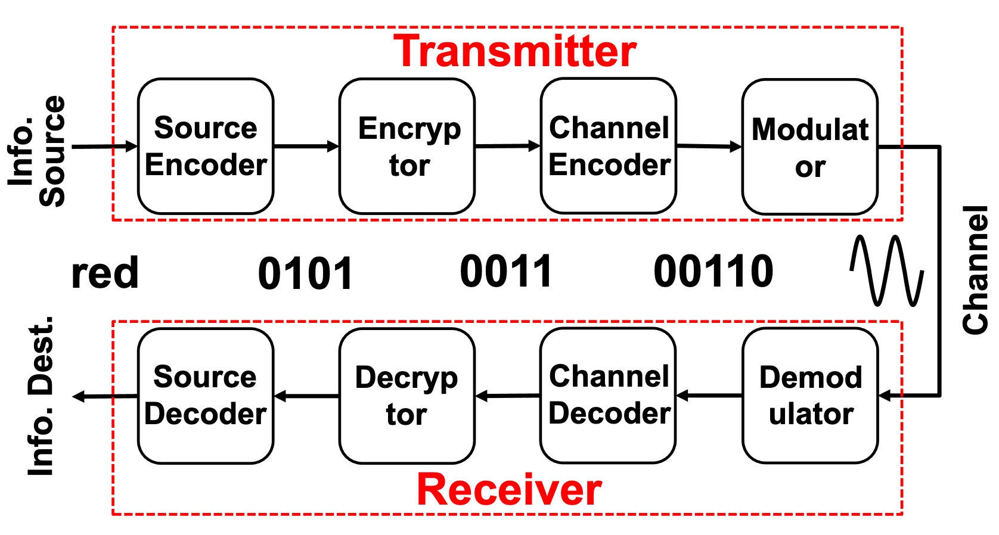
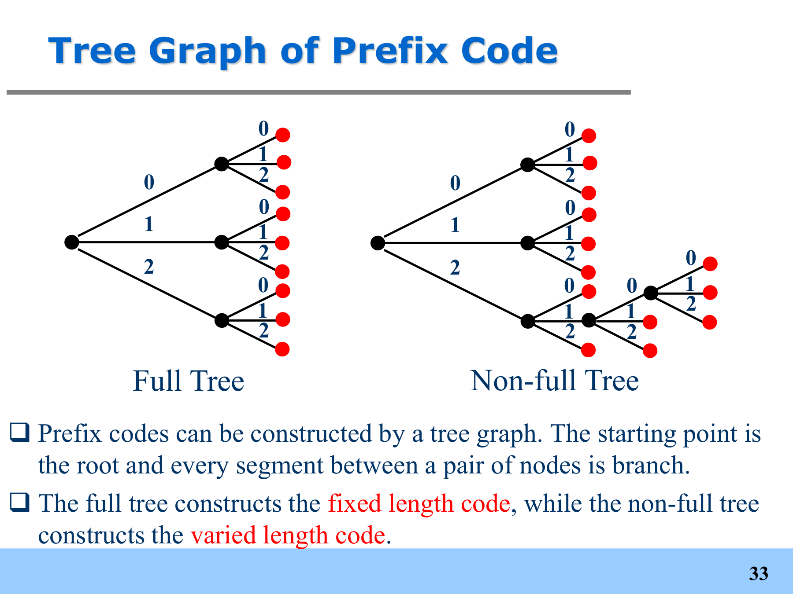

# 6 Lossless Source Coding

<LyricCover
  image="IT-Lecture-6.attachments/1783256213589.JPG"
  title="Chinatown Blues"
  artist="Karma Wears White Ties / GUMI / ODDEEO"
  lang="en"
  netease-url="https://music.163.com/#/song?id=545728377"
>
  <LyricLine
    original="No matter what you do, I'll stay. This isn't up to you, today."
    translation="无论你在何处我都在，今天这不取决于你。"
  />
  <LyricLine
    original="It hasn't always been, this way. I've got a lot to prove, today."
    translation="并非总是如此，今天我将证明。"
  />
</LyricCover>

## 章节目录

- [章节目录](#章节目录)
- [6-1 信源编码基础 Fundamentals of Source Coding](#6-1-信源编码基础-fundamentals-of-source-coding)
  - [6-1-1 通信系统里的编码位置 Coding in Communication System](#6-1-1-通信系统里的编码位置-coding-in-communication-system)
  - [6-1-2 信源编码与无失真要求 Source Coding and Lossless Requirement](#6-1-2-信源编码与无失真要求-source-coding-and-lossless-requirement)
  - [6-1-3 唯一可译码 Unique Decodability](#6-1-3-唯一可译码-unique-decodability)
- [6-2 定长信源编码 Fixed-Length Source Coding](#6-2-定长信源编码-fixed-length-source-coding)
  - [6-2-1 消息、码元与信息率 Message, Code Element and Rate](#6-2-1-消息码元与信息率-message-code-element-and-rate)
  - [6-2-2 定长编码定理 Fixed-Length Coding Theorem](#6-2-2-定长编码定理-fixed-length-coding-theorem)
- [6-3 变长码与前缀码 Variable-Length and Prefix Codes](#6-3-变长码与前缀码-variable-length-and-prefix-codes)
  - [6-3-1 变长编码定理 Variable-Length Coding Theorem](#6-3-1-变长编码定理-variable-length-coding-theorem)
  - [6-3-2 编码效率与同步问题 Coding Efficiency and Synchronisation](#6-3-2-编码效率与同步问题-coding-efficiency-and-synchronisation)
  - [6-3-3 前缀码与 Kraft 不等式 Prefix Code and Kraft Inequality](#6-3-3-前缀码与-kraft-不等式-prefix-code-and-kraft-inequality)
- [6-4 经典无失真编码 Classic Lossless Coding Schemes](#6-4-经典无失真编码-classic-lossless-coding-schemes)
  - [6-4-1 Shannon 编码 Shannon Code](#6-4-1-shannon-编码-shannon-code)
  - [6-4-2 Fano 编码 Fano Code](#6-4-2-fano-编码-fano-code)
  - [6-4-3 Huffman 编码 Huffman Code](#6-4-3-huffman-编码-huffman-code)
  - [6-4-4 三种编码方法对比 Comparison](#6-4-4-三种编码方法对比-comparison)

## 6-1 信源编码基础 Fundamentals of Source Coding

### 6-1-1 通信系统里的编码位置 Coding in Communication System

一个通信系统可以被如下框图描述：

在这条链路里，三类编码的目标不同：

| 编码 Coding | 主要目标 Main Goal | 熵的变化 |
| --- | --- | --- |
| **信源编码 Source Coding** | 减少冗余，用更低速率传输同样信息 | 压缩冗余，接近信源熵 |
| **信道编码 Channel Coding** | 增加冗余，提高抗噪声能力 | 主动加入冗余 |
| **加密编码 Cryptogram** | 提高传输安全性 | 加密增加不确定性，解密恢复可读信息 |

信源编码讨论的是信息被送入信道之前的压缩问题。

---

### 6-1-2 信源编码与无失真要求 Source Coding and Lossless Requirement

::: definition 信源编码 Source Coding

**信源编码 Source Coding** 指使用更适合传输或存储的**码序列 Code Sequence** 表示信源产生的原始消息。

这一步由 **编码器 Encoder** 完成。

:::

设离散信源产生长度为 $L$ 的随机序列：

$$
\mathbf X
=
\begin{bmatrix}
X_1 & X_2 & \cdots & X_l & \cdots & X_L
\end{bmatrix},
\qquad
X_l\in\{a_1,a_2,\cdots,a_n\}.
$$

信源编码把它映射成长度为 $K$ 的码序列：

$$
\mathbf Y
=
\begin{bmatrix}
Y_1 & Y_2 & \cdots & Y_k & \cdots & Y_K
\end{bmatrix},
\qquad
Y_k\in\{b_1,b_2,\cdots,b_m\}.
$$

其中 $\{b_1,b_2,\cdots,b_m\}$ 是编码系统可识别的码元集合。二进制编码时 $m=2$，码元就是 $0$ 与 $1$。

::: definition 无失真编码 Lossless Coding

**无失真编码 Lossless Coding** 要求信源产生的每个消息都能映射到唯一的码字，且每个码字也只能被译码成唯一的原消息。

从熵的角度看，无失真对应：

$$
H(X\mid Y)=0.
$$

给定码字 $Y$ 后，原消息 $X$ 没有剩余疑义。

:::

---

### 6-1-3 唯一可译码 Unique Decodability

::: definition 唯一可译码 Unique Decodability

若任意一串信源符号

$$
x_1x_2\cdots x_n
$$

经过编码后得到的码串，与任意另一串信源符号的编码结果都不同，则该编码是**唯一可译码 Unique Decodable** 的。

:::

唯一可译码比“每个单独符号码字不同”更强。码字拼接后仍不能产生歧义。

例如：

$$
a\to 0,\qquad b\to 01,\qquad c\to 10.
$$

则：

$$
ac\to 010,
\qquad
ba\to 010.
$$

译码器看到 $010$ 时无法判断原消息是 $ac$ 还是 $ba$，因此该码不是唯一可译码。

## 6-2 定长信源编码 Fixed-Length Source Coding

### 6-2-1 消息、码元与信息率 Message, Code Element and Rate

**消息 Message** 是信源产生的抽象符号，例如字母、标点、天气状态或设备状态。

**码元 Code Element** 是通信系统可以识别的编码基本单位，例如二进制码中的 $0$ 和 $1$。

对长度为 $L$ 的信源序列，若编码后得到 $K$ 个 $m$ 元码元，则平均到每个信源符号的信息率为：

$$
R
=
\frac{K}{L}\log_2 m
\qquad
(\mathrm{bit/source\ symbol}).
$$

当 $m=2$ 时：

$$
R=\frac{K}{L}.
$$

定长码和变长码的区别在于 $K$ 的处理方式：

| 类型 Type | 码字长度 Codeword Length | 目标 |
| --- | --- | --- |
| **定长码 Fixed-Length Code** | 每个码字长度固定 | 找到能低错误译码的最小固定长度 $K$ |
| **变长码 Variable-Length Code** | 不同消息可用不同长度 | 最小化平均码长 $\bar K$ |

---

### 6-2-2 定长编码定理 Fixed-Length Coding Theorem

设 $\mathbf X$ 是平稳无记忆信源，单符号熵为 $H(X)$。把 $L$ 个信源符号一起编码为 $K$ 个 $m$ 元码元，其信息率为：

$$
R=\frac{K}{L}\log_2 m.
$$

::: definition 定长无失真信源编码定理 Fixed-Length Lossless Source Coding Theorem

该定理又称**香农第一定理 Shannon's First Theorem**。

对任意 $\varepsilon>0$ 与 $\delta>0$：

若

$$
R\ge H(X)+\varepsilon,
$$

则当 $L$ 足够大时，译码错误概率可以低于 $\delta$。

若

$$
R\le H(X)-2\varepsilon,
$$

则当 $L$ 足够大时，译码错误无法避免。

:::

这个定理给出的是极限结论。只要允许把足够长的符号序列作为整体编码，定长编码的效率可以任意接近 $1$：

$$
\lim_{L\to\infty}
\frac{H(X)}{\frac{K}{L}\log_2 m}
=1.
$$

实际中不可能真的取 $L\to\infty$。序列越长，编码器需要维护的典型序列集合越大，复杂度和延迟都会上升。

理想定长编码器的思路是：

1. 给定 $\varepsilon$ 和 $\delta$，估计需要一起编码的序列长度 $L$；
2. 列出所有长度为 $L$ 的可能符号序列；
3. 按发送概率从大到小排序；
4. 只给高概率集合 $A_\varepsilon$ 分配码字，使 $p(A_\varepsilon)\ge 1-\delta$。

其中常用的长度估计式为：

$$
L\ge
\frac{\operatorname{Var}[I(a_i)]}{\varepsilon^2\delta}.
$$

:::: stem IT6-E1

设平稳无记忆信源 $X$ 的概率分布为：

$$
\begin{bmatrix}
X\\
p(X)
\end{bmatrix}
=
\begin{bmatrix}
a_1 & a_2 & a_3 & a_4\\
\frac12 & \frac14 & \frac18 & \frac18
\end{bmatrix}.
$$

用二进制定长码分别编码单符号消息和二符号消息，讨论编码效率与错误概率。

::::

:::: solution

信源熵为：

$$
\begin{aligned}
H(X)
&=
-\frac12\log_2\frac12
-\frac14\log_2\frac14
-\frac18\log_2\frac18
-\frac18\log_2\frac18\\
&=1.75\ \mathrm{bit/sign}.
\end{aligned}
$$

若对每个单符号使用二进制定长码，需要：

$$
K=\lceil\log_2 4\rceil=2.
$$

编码效率为：

$$
\eta
=
\frac{H(X)}{K}
=
\frac{1.75}{2}
=87.5\%.
$$

此时四个单符号都能被编码，译码错误率为 $0$。

若把两个符号作为一个消息，则共有 $4^2=16$ 个二符号消息。若只使用 $K=3$ 位二进制码，最多只能表示 $2^3=8$ 个消息，无法覆盖全部消息。

二符号信源熵为：

$$
H(X^2)=2H(X)=3.5\ \mathrm{bit/block}.
$$

而 $3$ 位定长码的信息率低于二符号块的熵。若只编码概率最大的 $8$ 个二符号消息，其总概率为：

$$
p(A)=0.8125.
$$

因此未被覆盖的概率约为：

$$
P_e=1-p(A)=0.1875.
$$

这里效率高于 $100\%$ 的表象来自“丢掉了低概率消息”，不是无失真编码真正突破了熵下界。

::::

## 6-3 变长码与前缀码 Variable-Length and Prefix Codes

### 6-3-1 变长编码定理 Variable-Length Coding Theorem

变长码的基本原则是：

- 高频消息用短码字；
- 低频消息用长码字；
- 最终降低平均码长。

设离散无记忆信源 $X$ 的熵为 $H(X)$。用 $m$ 元变长码对单符号编码时，存在无失真编码，使平均码长 $\bar K$ 满足：

$$
\frac{H(X)}{\log_2 m}
\le
\bar K
<
\frac{H(X)}{\log_2 m}+1.
$$

若每次把长度为 $L$ 的信源序列一起编码，则：

$$
\frac{LH(X)}{\log_2 m}
\le
\bar K
<
\frac{LH(X)}{\log_2 m}+1.
$$

对应的平均信息率为：

$$
\bar R
=
\frac{\bar K}{L}\log_2 m.
$$

因此：

$$
H(X)
\le
\bar R
<
H(X)+\frac{\log_2 m}{L}.
$$

当 $L$ 增大时，变长编码也能逼近熵下界。区别在于，它通常不需要像定长典型序列编码那样取非常大的 $L$。

---

### 6-3-2 编码效率与同步问题 Coding Efficiency and Synchronisation

变长码编码效率定义为：

$$
\eta
=
\frac{H(X)}{\bar R}.
$$

由上一节的不等式可得下界：

$$
\eta
>
\frac{H(X)}
{H(X)+\frac{\log_2 m}{L}}.
$$

对二进制码，若某信源熵为：

$$
H(X)=2.5524\ \mathrm{bit/sign},
$$

要求 $\eta>90\%$，则只需：

$$
\frac{H(X)}{H(X)+\frac{1}{L}}>0.9.
$$

代入可得：

$$
L>3.53.
$$

因此取：

$$
L=4.
$$

变长码的代价是译码复杂度更高。译码器需要判断一个码字何时结束，这涉及**同步译码 Synchronous Decoding** 和**译码延迟 Decoding Delay**。

---

### 6-3-3 前缀码与 Kraft 不等式 Prefix Code and Kraft Inequality

::: definition 前缀码 Prefix Code

若任意一个码字都不是另一个码字的前缀，则该编码称为**前缀码 Prefix Code**。

前缀码也称为**即时码 Instantaneous Code**，因为译码器读到一个完整码字后可以立刻译码，不需要等待后续码元。

:::

前缀码一定是唯一可译码，但唯一可译码不一定是前缀码。

前缀码可以用树图表示：

定长码对应满树，变长码对应非满树。每个叶节点是一个码字，内部节点不能作为码字，否则会成为其他码字的前缀。

::: definition Kraft 不等式 Kraft Inequality

存在一个 $m$ 元前缀码，其码字长度分别为 $k_1,k_2,\cdots,k_n$ 的必要充分条件为：

$$
\sum_{i=1}^{n}m^{-k_i}\le 1.
$$

:::

若对每个消息 $a_i$ 取码长：

$$
k_i
=
\left\lceil
\frac{-\log_2 p(a_i)}{\log_2 m}
\right\rceil,
$$

则：

$$
\frac{-\log_2 p(a_i)}{\log_2 m}
\le k_i
<
\frac{-\log_2 p(a_i)}{\log_2 m}+1.
$$

于是：

$$
m^{-k_i}\le p(a_i),
\qquad
\sum_{i=1}^{n}m^{-k_i}\le \sum_{i=1}^{n}p(a_i)=1.
$$

因此这种码长分配满足 Kraft 不等式，可以构造前缀码。

## 6-4 经典无失真编码 Classic Lossless Coding Schemes

### 6-4-1 Shannon 编码 Shannon Code

**Shannon 编码 Shannon Code** 直接按照消息概率确定码长，再用累积概率生成码字。

二进制 Shannon 编码步骤：

1. 按概率从大到小排列信源符号；
2. 计算第 $i$ 个符号之前的累积概率

$$
F_i=\sum_{r=1}^{i-1}p(a_r),
\qquad F_1=0.
$$

3. 取码长

$$
k_i=\left\lceil-\log_2 p(a_i)\right\rceil.
$$

4. 将 $F_i$ 写成二进制小数，取小数点后 $k_i$ 位作为 $a_i$ 的码字。

:::: stem IT6-E2

对如下单符号信源进行二进制 Shannon 编码：

$$
\begin{bmatrix}
X\\
P(X)
\end{bmatrix}
=
\begin{bmatrix}
a_1&a_2&a_3&a_4&a_5&a_6\\
0.25&0.25&0.20&0.15&0.10&0.05
\end{bmatrix}.
$$

::::

:::: solution

| 符号 | $p(a_i)$ | $F_i$ | $k_i$ | Shannon 码字 |
| --- | ---: | ---: | ---: | --- |
| $a_1$ | $0.25$ | $0$ | $2$ | $00$ |
| $a_2$ | $0.25$ | $0.25$ | $2$ | $01$ |
| $a_3$ | $0.20$ | $0.50$ | $3$ | $100$ |
| $a_4$ | $0.15$ | $0.70$ | $3$ | $101$ |
| $a_5$ | $0.10$ | $0.85$ | $4$ | $1101$ |
| $a_6$ | $0.05$ | $0.95$ | $5$ | $11110$ |

平均码长为：

$$
\bar K
=
0.25(2)+0.25(2)+0.20(3)+0.15(3)+0.10(4)+0.05(5)
=2.7.
$$

信源熵为：

$$
H(X)=2.4232\ \mathrm{bit/sign}.
$$

编码效率为：

$$
\eta
=
\frac{H(X)}{\bar K}
=
\frac{2.4232}{2.7}
=89.75\%.
$$

::::

---

### 6-4-2 Fano 编码 Fano Code

**Fano 编码 Fano Code** 通过反复分组构造码字。

$m$ 元 Fano 编码步骤：

1. 按概率从大到小排列信源符号；
2. 将符号分成 $m$ 组，使各组概率和尽量接近；
3. 给每组分配一个码元；
4. 对每组继续递归分组，直到每组只剩一个符号。

对 6-4-1 中的同一信源，一种二进制 Fano 编码为：

| 符号 | $p(a_i)$ | Fano 码字 |
| --- | ---: | --- |
| $a_1$ | $0.25$ | $00$ |
| $a_2$ | $0.25$ | $01$ |
| $a_3$ | $0.20$ | $10$ |
| $a_4$ | $0.15$ | $110$ |
| $a_5$ | $0.10$ | $1110$ |
| $a_6$ | $0.05$ | $1111$ |

平均码长为：

$$
\bar K
=
0.25(2)+0.25(2)+0.20(2)+0.15(3)+0.10(4)+0.05(4)
=2.45.
$$

编码效率为：

$$
\eta
=
\frac{2.4232}{2.45}
=98.91\%.
$$

Fano 编码的分组通常不唯一。若某次分组概率和比较接近，编码效果会很好；若分组不理想，平均码长会被拉高。

---

### 6-4-3 Huffman 编码 Huffman Code

**Huffman 编码 Huffman Code** 每次合并最低概率的符号，最终从合并树回溯得到码字。

二进制 Huffman 编码步骤：

1. 按概率从大到小排列信源符号；
2. 取概率最低的两个符号，分别赋码元 $0$ 和 $1$；
3. 合并这两个符号，合并后概率为二者概率之和；
4. 对新的缩减信源重复上述过程，直到只剩两个符号；
5. 沿合并路径回溯，得到原符号的码字。

对 6-4-1 中的同一信源，一种二进制 Huffman 编码为：

| 符号 | $p(a_i)$ | Huffman 码字 |
| --- | ---: | --- |
| $a_1$ | $0.25$ | $01$ |
| $a_2$ | $0.25$ | $10$ |
| $a_3$ | $0.20$ | $00$ |
| $a_4$ | $0.15$ | $110$ |
| $a_5$ | $0.10$ | $1111$ |
| $a_6$ | $0.05$ | $1110$ |

平均码长同样为：

$$
\bar K=2.45.
$$

编码效率为：

$$
\eta=98.91\%.
$$

Huffman 编码不一定唯一。若缩减信源中出现相同概率，合并后的新符号可以排在相同概率符号之前或之后。不同排法可能得到相同平均码长，但码长方差不同。

对 $m$ 元 Huffman 编码，最后一轮缩减信源应有 $m$ 个符号。若原信源符号数不满足完整 $m$ 叉树条件：

$$
n=1+k(m-1),
$$

则需要加入若干零概率虚符号，或在第一轮合并时少合并几个真实符号。

---

### 6-4-4 三种编码方法对比 Comparison

三种编码方法都利用信源统计特性：概率大的符号分配短码字，概率小的符号分配长码字。

| 方法 | 是否唯一 | 主要特点 | 适用情况 |
| --- | --- | --- | --- |
| **Shannon Code** | 通常唯一 | 由累积概率直接生成，步骤固定 | 计算简单，但效率不一定高 |
| **Fano Code** | 不唯一 | 递归分组，依赖分组质量 | 分组后概率和接近时效果较好 |
| **Huffman Code** | 不唯一 | 每次合并最低概率符号 | 平均码长通常最优，工程上最常用 |

$$
\text{Shannon: 概率}\to\text{码长}\to\text{累积概率码字}
$$

$$
\text{Fano: 排序}\to\text{近似等概率分组}\to\text{递归}
$$

$$
\text{Huffman: 最小概率合并}\to\text{构造树}\to\text{回溯码字}
$$
