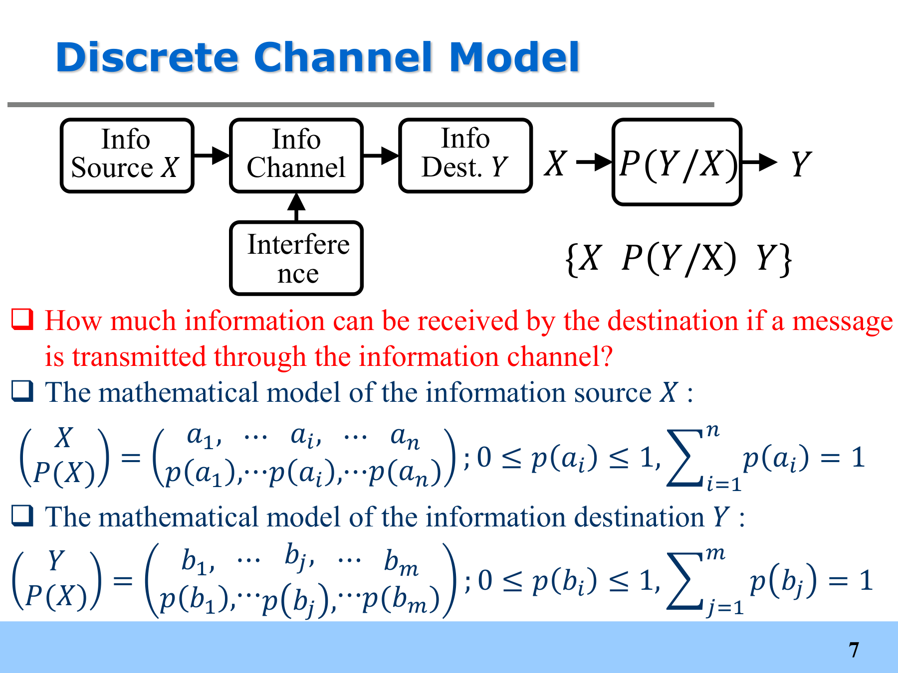
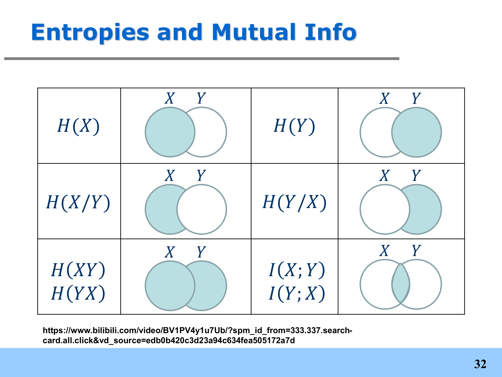

# 7 Mutual Self-Information and Mutual Information

<LyricCover
  image="IT-Lecture-7.attachments/1783256222470.jpg"
  title="オレンジスケール"
  artist="長瀬有花"
  lang="ja"
  furigana="hide"
  netease-url="https://music.163.com/#/song?id=1991309162"
>
  <LyricLine
    original="アスファルトの上(うえ) インクが広(ひろ)がった、たそがれの道(みち)は、"
    translation="墨水在柏油路上扩散，黄昏之中的道路，"
  />
  <LyricLine
    original="背伸(せの)びした はずの今日(きょう)も、いつのまに かしまって くみたいだ。"
    translation="本应该伸着懒腰的今天也，宛如在不知不觉中结束了。"
  />
</LyricCover>

## 章节目录

- [章节目录](#章节目录)
- [7-1 单符号离散信道 Single-Symbol Discrete Channel](#7-1-单符号离散信道-single-symbol-discrete-channel)
  - [7-1-1 前序回顾 Previous Lectures](#7-1-1-前序回顾-previous-lectures)
  - [7-1-2 离散信道模型 Discrete Channel Model](#7-1-2-离散信道模型-discrete-channel-model)
  - [7-1-3 先验、后验与联合概率 Prior, Posterior and Joint Probability](#7-1-3-先验后验与联合概率-prior-posterior-and-joint-probability)
- [7-2 互自信息 Mutual Self-Information](#7-2-互自信息-mutual-self-information)
  - [7-2-1 互自信息定义 Definition](#7-2-1-互自信息定义-definition)
  - [7-2-2 互自信息的物理意义 Physical Meaning](#7-2-2-互自信息的物理意义-physical-meaning)
  - [7-2-3 互自信息性质 Properties](#7-2-3-互自信息性质-properties)
  - [7-2-4 条件互自信息 Conditional Mutual Self-Information](#7-2-4-条件互自信息-conditional-mutual-self-information)
- [7-3 互信息 Mutual Information](#7-3-互信息-mutual-information)
  - [7-3-1 从互自信息到互信息 From Mutual Self-Information to Mutual Information](#7-3-1-从互自信息到互信息-from-mutual-self-information-to-mutual-information)
  - [7-3-2 三种等价表达 Equivalent Expressions](#7-3-2-三种等价表达-equivalent-expressions)
  - [7-3-3 二元信道例题 Binary Channel Example](#7-3-3-二元信道例题-binary-channel-example)
- [7-4 互信息性质与熵关系 Properties and Entropy Relationships](#7-4-互信息性质与熵关系-properties-and-entropy-relationships)
  - [7-4-1 互信息基本性质 Basic Properties](#7-4-1-互信息基本性质-basic-properties)
  - [7-4-2 函数性质 Functional Properties](#7-4-2-函数性质-functional-properties)
  - [7-4-3 数据处理不等式 Data-Processing Inequality](#7-4-3-数据处理不等式-data-processing-inequality)
  - [7-4-4 熵关系总表 Entropy Relationship Summary](#7-4-4-熵关系总表-entropy-relationship-summary)

## 7-1 单符号离散信道 Single-Symbol Discrete Channel

### 7-1-1 前序回顾 Previous Lectures

前几讲已经处理了三个问题：

1. 用**自信息 Self-information** 描述一个具体消息携带多少信息；
2. 用**熵 Entropy** 描述一个离散信源平均产生多少信息；
3. 用**信源编码 Source Coding** 把信源消息转换成码字，并减少冗余。

这一讲换到信道视角。问题变为：

$$
\text{信源发送了多少信息，信宿最终收到了多少？}
$$

信道有噪声时，接收端看到的 $Y$ 不一定等于发送端发出的 $X$。互信息就是用来量化 $X$ 与 $Y$ 之间统计关联的信息量。

---

### 7-1-2 离散信道模型 Discrete Channel Model

单符号离散信道可以写成：

信源 $X$ 的概率模型为：

$$
\begin{bmatrix}
X\\
P(X)
\end{bmatrix}
=
\begin{bmatrix}
a_1 & a_2 & \cdots & a_i & \cdots & a_n\\
p(a_1) & p(a_2) & \cdots & p(a_i) & \cdots & p(a_n)
\end{bmatrix},
$$

其中：

$$
0\le p(a_i)\le 1,
\qquad
\sum_{i=1}^{n}p(a_i)=1.
$$

信宿 $Y$ 的输出字母表为：

$$
Y\in\{b_1,b_2,\cdots,b_m\}.
$$

信道本身由转移概率描述：

$$
p(b_j\mid a_i),
\qquad
i=1,2,\cdots,n,
\quad
j=1,2,\cdots,m.
$$

若写成矩阵：

$$
P(Y\mid X)
=
\begin{bmatrix}
p(b_1\mid a_1) & p(b_2\mid a_1) & \cdots & p(b_m\mid a_1)\\
p(b_1\mid a_2) & p(b_2\mid a_2) & \cdots & p(b_m\mid a_2)\\
\vdots & \vdots & \ddots & \vdots\\
p(b_1\mid a_n) & p(b_2\mid a_n) & \cdots & p(b_m\mid a_n)
\end{bmatrix}.
$$

每一行对应一个已知输入 $a_i$ 下所有可能输出的概率，因此：

$$
\sum_{j=1}^{m}p(b_j\mid a_i)=1.
$$

---

### 7-1-3 先验、后验与联合概率 Prior, Posterior and Joint Probability

发送前，$a_i$ 的概率是先验概率：

$$
p(a_i).
$$

信道输出 $b_j$ 后，接收端再判断发送消息为 $a_i$ 的概率为后验概率：

$$
p(a_i\mid b_j).
$$

联合概率由信源分布和信道转移概率给出：

$$
p(a_i b_j)
=
p(a_i)p(b_j\mid a_i).
$$

输出端边缘概率为：

$$
p(b_j)
=
\sum_{i=1}^{n}p(a_i)p(b_j\mid a_i).
$$

后验概率由 Bayes 公式得到：

$$
p(a_i\mid b_j)
=
\frac{p(a_i b_j)}{p(b_j)}
=
\frac{p(a_i)p(b_j\mid a_i)}{p(b_j)}.
$$

理想信道没有噪声，输入能被无失真接收：

$$
p(b_j\mid a_i)
=
\begin{cases}
1, & j=i,\\
0, & j\ne i.
\end{cases}
$$

实际信道有噪声和干扰，$a_i$ 可能被接收成不同的 $b_j$。互信息要处理的就是这种不确定的输入输出关系。

## 7-2 互自信息 Mutual Self-Information

### 7-2-1 互自信息定义 Definition

::: definition 互自信息 Mutual Self-Information

接收端收到 $b_j$ 后，关于发送端消息 $a_i$ 获得的信息量称为 $a_i$ 与 $b_j$ 的**互自信息 Mutual Self-Information**：

$$
I(a_i;b_j)
=
\log_2
\frac{p(a_i\mid b_j)}{p(a_i)}.
$$

:::

用 Bayes 公式可得两个等价形式：

$$
I(a_i;b_j)
=
\log_2
\frac{p(b_j\mid a_i)}{p(b_j)}.
$$

也可以写成联合概率形式：

$$
I(a_i;b_j)
=
\log_2
\frac{p(a_i b_j)}{p(a_i)p(b_j)}.
$$

这三个式子在计算中都常用：

$$
\boxed{
I(a_i;b_j)
=
\log_2
\frac{p(a_i\mid b_j)}{p(a_i)}
=
\log_2
\frac{p(b_j\mid a_i)}{p(b_j)}
=
\log_2
\frac{p(a_i b_j)}{p(a_i)p(b_j)}
}
$$

:::: stem IT7-E1

设 2018 World Cup Final 中，France 在常规时间内的结果建模为：

$$
\begin{bmatrix}
X\\
P(X)
\end{bmatrix}
=
\begin{bmatrix}
a_1:\text{Win} & a_2:\text{Draw} & a_3:\text{Lose}\\
0.50 & 0.29 & 0.21
\end{bmatrix}.
$$

收到消息 $b_1=$ “France is unbeaten in 90 mins”。求 $I(a_i;b_1)$。

::::

:::: solution

$b_1$ 表示 France 未败，因此只可能对应 $a_1$ 或 $a_2$：

$$
p(b_1)=p(a_1)+p(a_2)=0.79.
$$

后验概率为：

$$
p(a_1\mid b_1)=\frac{0.50}{0.79},
\qquad
p(a_2\mid b_1)=\frac{0.29}{0.79},
\qquad
p(a_3\mid b_1)=0.
$$

于是：

$$
\begin{aligned}
I(a_1;b_1)
&=
\log_2
\frac{\frac{0.50}{0.79}}{0.50}
=
\log_2\frac{1}{0.79}
=0.3401\ \mathrm{bit},\\
I(a_2;b_1)
&=
\log_2
\frac{\frac{0.29}{0.79}}{0.29}
=
\log_2\frac{1}{0.79}
=0.3401\ \mathrm{bit}.
\end{aligned}
$$

对 $a_3$，收到 $b_1$ 后后验概率为 $0$，因此：

$$
I(a_3;b_1)=-\infty.
$$

这表示 $b_1$ 直接排除了 France lose 这个事件。

若天气信源为：

$$
\begin{bmatrix}
X\\
P(X)
\end{bmatrix}
=
\begin{bmatrix}
\text{sunny} & \text{cloudy} & \text{rainy} & \text{snowy}\\
\frac12 & \frac14 & \frac18 & \frac18
\end{bmatrix},
$$

收到 $b_1=$ “not sunny” 后：

$$
p(\text{cloudy}\mid b_1)
=
\frac{\frac14}{\frac12}
=
\frac12.
$$

所以：

$$
I(\text{cloudy};b_1)
=
\log_2
\frac{\frac12}{\frac14}
=1\ \mathrm{bit}.
$$

::::

---

### 7-2-2 互自信息的物理意义 Physical Meaning

从信源输入 $a_i$ 的角度看：

$$
\begin{aligned}
I(a_i;b_j)
&=
\log_2\frac{p(a_i\mid b_j)}{p(a_i)}\\
&=
-\log_2p(a_i)+\log_2p(a_i\mid b_j)\\
&=
I(a_i)-I(a_i\mid b_j).
\end{aligned}
$$

其中：

$$
I(a_i\mid b_j)=-\log_2p(a_i\mid b_j).
$$

因此，互自信息表示收到 $b_j$ 后，关于 $a_i$ 的不确定性减少量。

从信道输出 $b_j$ 的角度看：

$$
I(b_j;a_i)
=
I(b_j)-I(b_j\mid a_i).
$$

从整个通信系统看，若不知道 $X$ 与 $Y$ 之间有信道联系，则 $a_i$ 与 $b_j$ 同时出现的概率会被看成：

$$
p'(a_i b_j)=p(a_i)p(b_j).
$$

传输后，真实联合概率为：

$$
p(a_i b_j)=p(a_i)p(b_j\mid a_i).
$$

不确定性减少量为：

$$
\begin{aligned}
I(a_i;b_j)
&=
-\log_2[p(a_i)p(b_j)]
-[-\log_2p(a_i b_j)]\\
&=
\log_2
\frac{p(a_i b_j)}{p(a_i)p(b_j)}.
\end{aligned}
$$

这和定义一致。

---

### 7-2-3 互自信息性质 Properties

#### 1. 对称性

互自信息满足：

$$
I(a_i;b_j)=I(b_j;a_i).
$$

从联合概率形式可以直接看出：

$$
\frac{p(a_i b_j)}{p(a_i)p(b_j)}
=
\frac{p(b_j a_i)}{p(b_j)p(a_i)}.
$$

#### 2. 独立时为零

若 $X$ 与 $Y$ 独立，则：

$$
p(a_i b_j)=p(a_i)p(b_j).
$$

因此：

$$
I(a_i;b_j)=0.
$$

收到 $b_j$ 不会改变对 $a_i$ 的判断。

#### 3. 可正可负

由定义：

$$
I(a_i;b_j)
=
\log_2
\frac{p(a_i\mid b_j)}{p(a_i)}.
$$

因此：

$$
I(a_i;b_j)
\begin{cases}
>0, & p(a_i\mid b_j)>p(a_i),\\
=0, & p(a_i\mid b_j)=p(a_i),\\
<0, & p(a_i\mid b_j)<p(a_i).
\end{cases}
$$

正值表示 $b_j$ 支持 $a_i$，负值表示 $b_j$ 反而削弱 $a_i$ 的可能性。

---

### 7-2-4 条件互自信息 Conditional Mutual Self-Information

若还给定另一个消息 $c_k$，则 $a_i$ 与 $b_j$ 在 $c_k$ 条件下的互自信息为：

$$
I(a_i;b_j\mid c_k)
=
\log_2
\frac{p(a_i\mid b_jc_k)}
{p(a_i\mid c_k)}.
$$

联合消息 $b_jc_k$ 关于 $a_i$ 的互自信息为：

$$
I(a_i;b_jc_k)
=
\log_2
\frac{p(a_i\mid b_jc_k)}
{p(a_i)}.
$$

由定义可得链式关系：

$$
I(a_i;b_jc_k)
=
I(a_i;c_k)+I(a_i;b_j\mid c_k).
$$

这个式子和熵的链式法则类似。先看 $c_k$ 提供多少关于 $a_i$ 的信息，再看已知 $c_k$ 后，$b_j$ 还能额外提供多少信息。

## 7-3 互信息 Mutual Information

### 7-3-1 从互自信息到互信息 From Mutual Self-Information to Mutual Information

互自信息描述的是一对具体消息 $(a_i,b_j)$ 之间传递的信息量。不同消息对的互自信息一般不同。

要描述整个信源 $X$ 与信宿 $Y$ 之间平均传输了多少信息，需要对所有联合消息求数学期望。

::: definition 互信息 Mutual Information

**互信息 Mutual Information** 定义为互自信息在联合概率空间上的平均值：

$$
I(X;Y)
=
\sum_{i=1}^{n}\sum_{j=1}^{m}
p(a_i b_j)I(a_i;b_j).
$$

代入互自信息定义可得：

$$
I(X;Y)
=
\sum_{i=1}^{n}\sum_{j=1}^{m}
p(a_i b_j)
\log_2
\frac{p(a_i b_j)}{p(a_i)p(b_j)}.
$$

:::

互信息衡量的是 $X$ 与 $Y$ 的平均统计相关性。若信道完全失效，$X$ 与 $Y$ 独立，则互信息为 $0$；若信道无失真，$Y$ 完全确定 $X$，则互信息达到 $H(X)$。

---

### 7-3-2 三种等价表达 Equivalent Expressions

先定义条件熵：

$$
H(X\mid Y)
=
-\sum_{i=1}^{n}\sum_{j=1}^{m}
p(a_i b_j)\log_2p(a_i\mid b_j).
$$

它也叫**信道疑义度 Channel Equivocation** 或 **损失熵 Loss Entropy**，表示收到 $Y$ 后，对发送端 $X$ 仍有多少不确定性。

类似地：

$$
H(Y\mid X)
=
-\sum_{i=1}^{n}\sum_{j=1}^{m}
p(a_i b_j)\log_2p(b_j\mid a_i).
$$

它也叫**噪声熵 Noise Entropy**，表示已知输入 $X$ 时，信道噪声对输出 $Y$ 引入了多少不确定性。

互信息有三个常用等价表达：

$$
\boxed{
I(X;Y)
=
H(X)-H(X\mid Y)
}
$$

$$
\boxed{
I(X;Y)
=
H(Y)-H(Y\mid X)
}
$$

$$
\boxed{
I(X;Y)
=
H(X)+H(Y)-H(XY)
}
$$

其中联合熵为：

$$
H(XY)
=
-\sum_{i=1}^{n}\sum_{j=1}^{m}
p(a_i b_j)\log_2p(a_i b_j).
$$

三种表达对应三个视角：

| 表达 | 含义 |
| --- | --- |
| $H(X)-H(X\mid Y)$ | 收到 $Y$ 后，关于信源 $X$ 的不确定性减少量 |
| $H(Y)-H(Y\mid X)$ | 已知 $X$ 后，关于信宿 $Y$ 的不确定性减少量 |
| $H(X)+H(Y)-H(XY)$ | 建立信道相关性后，整个系统总不确定性的减少量 |

---

### 7-3-3 二元信道例题 Binary Channel Example

:::: stem IT7-E2

信源 $X$ 的概率分布为：

$$
\begin{bmatrix}
X\\
P(X)
\end{bmatrix}
=
\begin{bmatrix}
a_1&a_2\\
0.6&0.4
\end{bmatrix}.
$$

信宿字母表为 $Y=\{b_1,b_2\}$，信道转移矩阵为：

$$
P(Y\mid X)
=
\begin{bmatrix}
\frac56 & \frac16\\
\frac14 & \frac34
\end{bmatrix}.
$$

计算 $H(X)$、$H(Y)$、$H(X\mid Y)$、$H(Y\mid X)$ 与 $I(X;Y)$。

::::

:::: solution

先算联合概率：

$$
\begin{aligned}
p(a_1b_1)&=0.6\cdot\frac56=0.5,\\
p(a_1b_2)&=0.6\cdot\frac16=0.1,\\
p(a_2b_1)&=0.4\cdot\frac14=0.1,\\
p(a_2b_2)&=0.4\cdot\frac34=0.3.
\end{aligned}
$$

因此：

$$
\begin{bmatrix}
XY\\
P(XY)
\end{bmatrix}
=
\begin{bmatrix}
a_1b_1&a_1b_2&a_2b_1&a_2b_2\\
0.5&0.1&0.1&0.3
\end{bmatrix}.
$$

输出端概率为：

$$
p(b_1)=0.5+0.1=0.6,
\qquad
p(b_2)=0.1+0.3=0.4.
$$

所以：

$$
H(X)=H(Y)
=
-0.6\log_2 0.6-0.4\log_2 0.4
=0.9710\ \mathrm{bit}.
$$

联合熵为：

$$
\begin{aligned}
H(XY)
&=
-0.5\log_2 0.5
-0.1\log_2 0.1
-0.1\log_2 0.1
-0.3\log_2 0.3\\
&=1.6855\ \mathrm{bit}.
\end{aligned}
$$

于是：

$$
H(X\mid Y)
=
H(XY)-H(Y)
=
1.6855-0.9710
=0.7145\ \mathrm{bit}.
$$

同理：

$$
H(Y\mid X)
=
H(XY)-H(X)
=0.7145\ \mathrm{bit}.
$$

互信息为：

$$
\begin{aligned}
I(X;Y)
&=
H(X)-H(X\mid Y)\\
&=
0.9710-0.7145\\
&=
0.2564\ \mathrm{bit}.
\end{aligned}
$$

也可以用联合熵表达：

$$
I(X;Y)
=
H(X)+H(Y)-H(XY)
=
0.9710+0.9710-1.6855
=0.2564\ \mathrm{bit}.
$$

后验概率可以顺手算出来：

$$
p(a_1\mid b_1)=\frac{0.5}{0.6}=\frac56,
\qquad
p(a_2\mid b_1)=\frac{0.1}{0.6}=\frac16.
$$

$$
p(a_1\mid b_2)=\frac{0.1}{0.4}=\frac14,
\qquad
p(a_2\mid b_2)=\frac{0.3}{0.4}=\frac34.
$$

收到 $b_1$ 时，$a_1$ 的可能性明显上升；收到 $b_2$ 时，$a_2$ 的可能性明显上升。因此互信息为正，但由于信道仍会混淆输入，互信息远小于 $H(X)$。

::::

## 7-4 互信息性质与熵关系 Properties and Entropy Relationships

### 7-4-1 互信息基本性质 Basic Properties

#### 1. 对称性

互信息满足：

$$
I(X;Y)=I(Y;X).
$$

该性质来自互自信息的对称性，也可以由联合熵表达直接得到：

$$
I(X;Y)=H(X)+H(Y)-H(XY).
$$

#### 2. 非负性

互信息非负：

$$
I(X;Y)\ge 0.
$$

最差情况下，$Y$ 与 $X$ 独立，接收端没有获得任何关于信源的信息，此时互信息为 $0$。

#### 3. 上界

由条件熵非负性：

$$
H(X\mid Y)\ge 0,
\qquad
H(Y\mid X)\ge 0.
$$

因此：

$$
I(X;Y)\le H(X),
\qquad
I(X;Y)\le H(Y).
$$

即：

$$
0\le I(X;Y)\le \min\{H(X),H(Y)\}.
$$

#### 4. 两个特殊信道

理想无噪声信道中，$Y$ 能完全确定 $X$：

$$
H(X\mid Y)=0,
\qquad
I(X;Y)=H(X).
$$

完全失效信道中，$X$ 与 $Y$ 独立：

$$
p(a_i b_j)=p(a_i)p(b_j),
\qquad
I(X;Y)=0.
$$

---

### 7-4-2 函数性质 Functional Properties

互信息由两部分决定：

1. 信源概率分布 $\{p(a_i)\}$；
2. 信道转移概率 $\{p(b_j\mid a_i)\}$。

因此可写成：

$$
I(X;Y)=f\{p(a_i),p(b_j\mid a_i)\}.
$$

若信道固定，即 $p(b_j\mid a_i)$ 给定，则互信息是信源分布 $\{p(a_i)\}$ 的凹函数：

$$
I(X;Y)=f'\{p(a_i)\}.
$$

这个性质会用于下一讲的**信道容量 Channel Capacity**：在给定信道下，寻找最优输入分布，使 $I(X;Y)$ 最大。

若信源固定，即 $p(a_i)$ 给定，则互信息是信道转移概率 $\{p(b_j\mid a_i)\}$ 的凸函数：

$$
I(X;Y)=f''\{p(b_j\mid a_i)\}.
$$

这个性质和后面的率失真理论有关。

---

### 7-4-3 数据处理不等式 Data-Processing Inequality

考虑级联信道：

$$
X\to Y\to Z.
$$

若给定 $Y$ 后，$X$ 与 $Z$ 条件独立，则 $X,Y,Z$ 构成 Markov 链。

::: definition 数据处理不等式 Data-Processing Inequality

对 Markov 链 $X\to Y\to Z$，有：

$$
I(X;Z)\le I(X;Y).
$$

:::

数据处理不会创造关于原始输入的新信息。它可以把数据变成更方便的形式，但不能让输出 $Z$ 比中间变量 $Y$ 含有更多关于 $X$ 的信息。

从条件熵角度看：

$$
H(X\mid Z)\ge H(X\mid Y).
$$

越往后处理，关于最初输入 $X$ 的疑义度不会降低。

如果对信宿进行多次观测，则情况相反。额外观测可以减少关于 $X$ 的条件熵：

$$
H(X\mid Y_1Y_2)\le H(X\mid Y_1).
$$

于是：

$$
I(X;Y_1Y_2)\ge I(X;Y_1).
$$

但无论观测多少次，能获得的信息不会超过信源自身熵：

$$
I(X;Y_1Y_2\cdots Y_n)\le H(X).
$$

---

### 7-4-4 熵关系总表 Entropy Relationship Summary

几个式子需要一起记：

$$
H(XY)=H(X)+H(Y\mid X).
$$

$$
H(XY)=H(Y)+H(X\mid Y).
$$

$$
I(X;Y)=H(X)-H(X\mid Y).
$$

$$
I(X;Y)=H(Y)-H(Y\mid X).
$$

$$
I(X;Y)=H(X)+H(Y)-H(XY).
$$

对应关系可以压成一张表：

| 量 | 公式 | 含义 |
| --- | --- | --- |
| $H(X)$ | $-\sum_i p(a_i)\log_2p(a_i)$ | 信源输入的不确定性 |
| $H(Y)$ | $-\sum_j p(b_j)\log_2p(b_j)$ | 信宿输出的不确定性 |
| $H(X\mid Y)$ | $H(XY)-H(Y)$ | 收到 $Y$ 后，关于 $X$ 的剩余疑义 |
| $H(Y\mid X)$ | $H(XY)-H(X)$ | 已知 $X$ 后，信道噪声造成的输出不确定性 |
| $H(XY)$ | $-\sum_{i,j}p(a_i b_j)\log_2p(a_i b_j)$ | 输入输出整体的不确定性 |
| $I(X;Y)$ | $H(X)+H(Y)-H(XY)$ | 输入和输出共享的信息量 |

考试里最稳的计算流程是：

1. 先由 $p(a_i)$ 和 $p(b_j\mid a_i)$ 写出联合概率 $p(a_i b_j)$；
2. 对联合概率按行、按列求边缘概率 $p(a_i)$、$p(b_j)$；
3. 先算 $H(X)$、$H(Y)$、$H(XY)$；
4. 再由

$$
H(X\mid Y)=H(XY)-H(Y),
\qquad
H(Y\mid X)=H(XY)-H(X)
$$

求条件熵；

5. 最后用任意一个等价式求 $I(X;Y)$。
