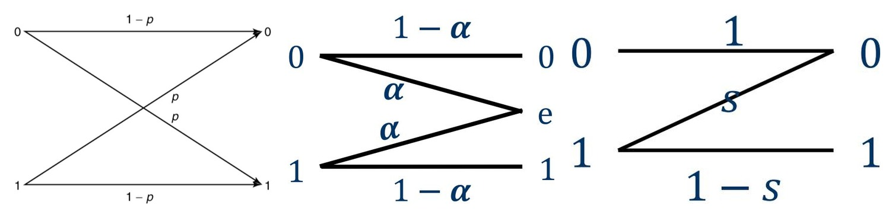

# 8 Discrete Channel Capacity

<LyricCover
  image="IT-Lecture-8.attachments/1783257022828.jpg"
  title="あの夏が飽和する。"
  artist="Kotoha"
  lang="ja"
  furigana="hide"
  netease-url="https://music.163.com/#/song?id=2006521134"
>
  <LyricLine
    original="九月(くがつ)の終(お)わりにくしゃみして"
    translation="在九月的最后打个喷嚏"
  />
  <LyricLine
    original="六月(ろくがつ)の匂(にお)いを繰(く)り返(かえ)す"
    translation="持续嗅着六月的气息"
  />
</LyricCover>

## 章节目录

- [章节目录](#章节目录)
- [8-1 信道容量定义 Definition of Channel Capacity](#8-1-信道容量定义-definition-of-channel-capacity)
  - [8-1-1 单符号离散信道回顾 Single-Symbol Discrete Channel](#8-1-1-单符号离散信道回顾-single-symbol-discrete-channel)
  - [8-1-2 信道容量 Channel Capacity](#8-1-2-信道容量-channel-capacity)
  - [8-1-3 多符号扩展信道 Multi-Symbol Expanded Channel](#8-1-3-多符号扩展信道-multi-symbol-expanded-channel)
- [8-2 典型无噪信道 Typical Noiseless Channels](#8-2-典型无噪信道-typical-noiseless-channels)
  - [8-2-1 一一映射信道 One-to-One Mapping](#8-2-1-一一映射信道-one-to-one-mapping)
  - [8-2-2 非重叠扩展输出 Nonoverlapping Outputs](#8-2-2-非重叠扩展输出-nonoverlapping-outputs)
  - [8-2-3 合并信道 Merging Channel](#8-2-3-合并信道-merging-channel)
- [8-3 对称信道 Symmetric Channels](#8-3-对称信道-symmetric-channels)
  - [8-3-1 二元对称信道 Binary Symmetric Channel](#8-3-1-二元对称信道-binary-symmetric-channel)
  - [8-3-2 强对称信道 Strongly Symmetric Channel](#8-3-2-强对称信道-strongly-symmetric-channel)
  - [8-3-3 弱对称信道 Weakly Symmetric Channel](#8-3-3-弱对称信道-weakly-symmetric-channel)
  - [8-3-4 二元擦除信道 Binary Erasure Channel](#8-3-4-二元擦除信道-binary-erasure-channel)
- [8-4 一般离散信道容量 Generic Discrete Channel Capacity](#8-4-一般离散信道容量-generic-discrete-channel-capacity)
  - [8-4-1 拉格朗日条件 Lagrange Condition](#8-4-1-拉格朗日条件-lagrange-condition)
  - [8-4-2 Z 信道 Z-Channel](#8-4-2-z-信道-z-channel)
  - [8-4-3 计算检查表 Calculation Checklist](#8-4-3-计算检查表-calculation-checklist)

## 8-1 信道容量定义 Definition of Channel Capacity

### 8-1-1 单符号离散信道回顾 Single-Symbol Discrete Channel

单符号离散信道由输入字母表、输出字母表和转移概率描述：

$$
X\in\{a_1,a_2,\cdots,a_n\},
\qquad
Y\in\{b_1,b_2,\cdots,b_m\}.
$$

信道转移矩阵写为：

$$
P(Y\mid X)
=
\begin{bmatrix}
p(b_1\mid a_1) & p(b_2\mid a_1) & \cdots & p(b_m\mid a_1)\\
p(b_1\mid a_2) & p(b_2\mid a_2) & \cdots & p(b_m\mid a_2)\\
\vdots & \vdots & \ddots & \vdots\\
p(b_1\mid a_n) & p(b_2\mid a_n) & \cdots & p(b_m\mid a_n)
\end{bmatrix}.
$$

每一行是给定输入 $a_i$ 后的输出分布，因此：

$$
\sum_{j=1}^{m}p(b_j\mid a_i)=1,
\qquad
i=1,2,\cdots,n.
$$

输出分布由输入分布和转移矩阵共同决定：

$$
p(b_j)=\sum_{i=1}^{n}p(a_i)p(b_j\mid a_i).
$$

互信息表示每使用一次信道，输入 $X$ 向输出 $Y$ 传递的平均信息量：

$$
I(X;Y)
=
\sum_{i=1}^{n}\sum_{j=1}^{m}
p(a_i)p(b_j\mid a_i)
\log_2\frac{p(b_j\mid a_i)}{p(b_j)}.
$$

---

### 8-1-2 信道容量 Channel Capacity

当信道固定时，转移概率 $p(b_j\mid a_i)$ 固定，互信息 $I(X;Y)$ 只随输入分布 $\{p(a_i)\}$ 改变。

::: definition 信道容量 Channel Capacity

**信道容量 Channel Capacity** 定义为在所有输入分布中能够达到的最大互信息：

$$
\boxed{
C
=
\max_{\{p(a_i)\}}I(X;Y)
}
\qquad
(\mathrm{bit/symbol}).
$$

:::

若每个信道符号传输时间为 $t$ 秒，则单位时间信道容量为：

$$
C_t
=
\frac{1}{t}C
=
\frac{1}{t}\max_{\{p(a_i)\}}I(X;Y)
\qquad
(\mathrm{bit/s}).
$$

信道容量只由信道统计性质决定。最优输入分布记为 $\{p^\ast(a_i)\}$，则：

$$
C
=
I\left(\{p^\ast(a_i)\},\{p(b_j\mid a_i)\}\right).
$$

---

### 8-1-3 多符号扩展信道 Multi-Symbol Expanded Channel

把单符号信道独立使用 $N$ 次，可得到 $N$ 阶无记忆扩展信道：

$$
\boldsymbol X
=
X_1X_2\cdots X_N,
\qquad
\boldsymbol Y
=
Y_1Y_2\cdots Y_N.
$$

若输入序列为 $\alpha_i=a_{i_1}a_{i_2}\cdots a_{i_N}$，输出序列为 $\beta_j=b_{j_1}b_{j_2}\cdots b_{j_N}$，无记忆条件给出：

$$
p(\beta_j\mid\alpha_i)
=
\prod_{k=1}^{N}
p(b_{j_k}\mid a_{i_k}).
$$

噪声熵满足：

$$
H(\boldsymbol Y\mid\boldsymbol X)
=
\sum_{k=1}^{N}H(Y_k\mid X_k).
$$

互信息满足：

$$
I(\boldsymbol X;\boldsymbol Y)
\le
\sum_{k=1}^{N}I(X_k;Y_k).
$$

若输入也是无记忆扩展信源，并且每次使用相同信道，则取等号：

$$
I(\boldsymbol X;\boldsymbol Y)=N I(X;Y),
\qquad
\boxed{
C^{(N)}=NC
}.
$$

## 8-2 典型无噪信道 Typical Noiseless Channels

### 8-2-1 一一映射信道 One-to-One Mapping

一一映射信道中，每个输入符号对应唯一输出符号，输出也能反推出输入。转移矩阵可写成单位矩阵或列置换矩阵。

对于 $n$ 个输入符号：

$$
H(X\mid Y)=0,
\qquad
I(X;Y)=H(X).
$$

容量为输入熵的最大值：

$$
\boxed{
C
=
\max_{\{p(a_i)\}}H(X)
=
\log_2 n
}.
$$

当输入等概率时达到容量：

$$
p^\ast(a_i)=\frac{1}{n},
\qquad
i=1,2,\cdots,n.
$$

---

### 8-2-2 非重叠扩展输出 Nonoverlapping Outputs

非重叠扩展输出中，一个输入可能对应多个输出，但不同输入对应的输出集合互不重叠。接收端看到输出后仍能唯一判断输入。

典型转移矩阵具有分块非重叠结构：

$$
P(Y\mid X)
=
\begin{bmatrix}
p(b_1\mid a_1) & p(b_2\mid a_1) & 0 & 0 & 0\\
0 & 0 & p(b_3\mid a_2) & p(b_4\mid a_2) & 0\\
0 & 0 & 0 & 0 & p(b_5\mid a_3)
\end{bmatrix}.
$$

虽然输出符号有随机性，但这种随机性不造成输入判决歧义。因此仍有：

$$
H(X\mid Y)=0,
\qquad
I(X;Y)=H(X).
$$

若输入字母表大小为 $n$，容量仍为：

$$
C=\log_2 n.
$$

---

### 8-2-3 合并信道 Merging Channel

合并信道中，多个输入可能映射到同一个输出。输出不能完整区分输入，因此信息会损失。

例如：

$$
a_1,a_2\mapsto b_1,
\qquad
a_3,a_4\mapsto b_2,
\qquad
a_5\mapsto b_3.
$$

此时 $Y$ 是 $X$ 的确定函数，所以：

$$
H(Y\mid X)=0,
\qquad
I(X;Y)=H(Y).
$$

若输出字母表有 $m$ 个符号，最大输出熵为 $\log_2 m$，故：

$$
\boxed{
C
=
\max_{\{p(a_i)\}}H(Y)
=
\log_2 m
}.
$$

合并信道的容量由可区分输出类别数决定，而不是由输入符号总数决定。

## 8-3 对称信道 Symmetric Channels

### 8-3-1 二元对称信道 Binary Symmetric Channel

**二元对称信道 Binary Symmetric Channel, BSC** 的转移矩阵为：

$$
P(Y\mid X)
=
\begin{bmatrix}
1-p & p\\
p & 1-p
\end{bmatrix}.
$$

其中 $p$ 是交叉概率。给定输入后，条件熵为：

$$
H(Y\mid X=x)=H_2(p),
$$

其中二元熵函数为：

$$
H_2(p)
=
-p\log_2 p-(1-p)\log_2(1-p).
$$

于是：

$$
I(X;Y)
=
H(Y)-H(Y\mid X)
=
H(Y)-H_2(p)
\le
1-H_2(p).
$$

当输入等概率时，输出也等概率，$H(Y)=1$。因此 BSC 容量为：

$$
\boxed{
C_{\mathrm{BSC}}
=
1-H_2(p)
}.
$$

---

### 8-3-2 强对称信道 Strongly Symmetric Channel

强对称信道的每一行互为排列，每一列也互为排列。若每一行的概率向量为：

$$
\boldsymbol r=(q_1,q_2,\cdots,q_m),
$$

则：

$$
H(Y\mid X)=H(\boldsymbol r).
$$

由于列也对称，输入等概率会诱导输出等概率：

$$
p^\ast(a_i)=\frac{1}{n}
\quad\Longrightarrow\quad
H(Y)=\log_2 m.
$$

所以强对称信道容量为：

$$
\boxed{
C
=
\log_2 m-H(q_1,q_2,\cdots,q_m)
}.
$$

对 $n$ 元强对称信道，若正确接收概率为 $\bar p=1-p$，错误时均匀落到其余 $n-1$ 个符号上：

$$
P
=
\begin{bmatrix}
\bar p & \frac{p}{n-1} & \cdots & \frac{p}{n-1}\\
\frac{p}{n-1} & \bar p & \cdots & \frac{p}{n-1}\\
\vdots & \vdots & \ddots & \vdots\\
\frac{p}{n-1} & \frac{p}{n-1} & \cdots & \bar p
\end{bmatrix}.
$$

容量为：

$$
\boxed{
C
=
\log_2 n
+\bar p\log_2\bar p
+p\log_2\frac{p}{n-1}
}.
$$

---

### 8-3-3 弱对称信道 Weakly Symmetric Channel

弱对称信道要求所有行互为排列，且每一列的列和相同。设行概率仍为：

$$
\boldsymbol r=(q_1,q_2,\cdots,q_m).
$$

输入等概率时，列和相同保证输出等概率，因此容量形式与强对称信道相同：

$$
C
=
\log_2 m-H(\boldsymbol r).
$$

若输出列可分为 $s$ 个互不相交的对称子块，第 $k$ 个子块包含 $m_k$ 个输出符号，且在等概率输入下该子块内输出概率平均值为 $\bar p(M_k)$，则容量可写为：

$$
C
=
-
\sum_{k=1}^{s}
m_k\bar p(M_k)\log_2\bar p(M_k)
-
H(q_1,q_2,\cdots,q_m).
$$

这种写法适合分块弱对称信道。计算时先按输出列分块，再分别计算每个子块的输出概率。

---

### 8-3-4 二元擦除信道 Binary Erasure Channel

**二元擦除信道 Binary Erasure Channel, BEC** 的输出字母表为：

$$
Y\in\{0,e,1\}.
$$

其中 $e$ 表示擦除。转移矩阵为：

$$
P(Y\mid X)
=
\begin{bmatrix}
1-\alpha & \alpha & 0\\
0 & \alpha & 1-\alpha
\end{bmatrix}.
$$

给定输入后，输出只在“正确接收”和“擦除”之间随机：

$$
H(Y\mid X)=H_2(\alpha).
$$

设 $\Pr(X=1)=\pi$。输出熵可分解为：

$$
H(Y)
=
H_2(\alpha)+(1-\alpha)H_2(\pi).
$$

因此：

$$
I(X;Y)
=
H(Y)-H(Y\mid X)
=
(1-\alpha)H_2(\pi).
$$

当 $\pi=\frac12$ 时达到最大值：

$$
\boxed{
C_{\mathrm{BEC}}
=
1-\alpha
}.
$$

擦除比例为 $\alpha$，可可靠携带信息的比例为 $1-\alpha$。

## 8-4 一般离散信道容量 Generic Discrete Channel Capacity

### 8-4-1 拉格朗日条件 Lagrange Condition

一般离散信道求容量要解：

$$
\max_{\{p(a_i)\}}I(X;Y),
\qquad
\sum_{i=1}^{n}p(a_i)=1.
$$

对最优输入分布 $p^\ast(a_i)$，KKT 条件可写成：

$$
D\!\left(P_{Y\mid X=a_i}\Vert P_Y^\ast\right)
\le
C,
$$

其中：

$$
D\!\left(P_{Y\mid X=a_i}\Vert P_Y^\ast\right)
=
\sum_{j=1}^{m}
p(b_j\mid a_i)
\log_2\frac{p(b_j\mid a_i)}{p^\ast(b_j)}.
$$

若 $p^\ast(a_i)>0$，则取等号：

$$
D\!\left(P_{Y\mid X=a_i}\Vert P_Y^\ast\right)
=
C.
$$

这条式子说明，所有真正被使用的输入符号，对最优输出分布的相对熵相同。

课程中常用的计算形式如下。先求 $\beta_j$：

$$
\sum_{j=1}^{m}
p(b_j\mid a_i)\beta_j
=
\sum_{j=1}^{m}
p(b_j\mid a_i)\log_2 p(b_j\mid a_i),
\qquad
i=1,2,\cdots,n.
$$

若该线性方程组可解，则：

$$
\boxed{
C=\log_2\sum_{j=1}^{m}2^{\beta_j}
}.
$$

最优输出分布满足：

$$
p^\ast(b_j)
=
2^{\beta_j-C}.
$$

最后由：

$$
p^\ast(b_j)
=
\sum_{i=1}^{n}p^\ast(a_i)p(b_j\mid a_i)
$$

反解最优输入分布。若解中出现负概率，则说明某些输入符号在最优分布中应被剔除，再对剩余输入重新计算。

---

### 8-4-2 Z 信道 Z-Channel

Z 信道的特点是一个方向无误，另一个方向可能出错：

$$
P(Y\mid X)
=
\begin{bmatrix}
1 & 0\\
s & 1-s
\end{bmatrix}.
$$

设：

$$
x=\Pr(X=1).
$$

则：

$$
\Pr(Y=1)=(1-s)x.
$$

互信息为：

$$
I(X;Y)
=
H_2((1-s)x)-xH_2(s).
$$

对 $x$ 求导并令导数为零，可得容量：

$$
\boxed{
C_{\mathrm Z}
=
\log_2\left[
1+(1-s)s^{\frac{s}{1-s}}
\right]
}.
$$

对应最优输入分布为：

$$
p^\ast(0)
=
\frac{1-s^{\frac{1}{1-s}}}
{1+(1-s)s^{\frac{s}{1-s}}},
\qquad
p^\ast(1)
=
\frac{s^{\frac{s}{1-s}}}
{1+(1-s)s^{\frac{s}{1-s}}}.
$$

特别地，当 $s=\frac12$ 时：

$$
C
=
\log_2\frac54
\approx
0.322\ \mathrm{bit/symbol}.
$$

---

### 8-4-3 计算检查表 Calculation Checklist

离散信道容量题通常按以下顺序处理：

1. 写出 $P(Y\mid X)$，确认每一行概率和为 $1$。
2. 判断是否为无噪、一一映射、合并、BSC、BEC、强对称、弱对称或 Z 信道。
3. 若是特殊信道，直接使用对应容量公式。
4. 若不是特殊信道，写出：

$$
I(X;Y)
=
H(Y)-H(Y\mid X)
$$

并把它化为输入分布参数的函数。

5. 对输入分布求极值，同时检查边界点。
6. 得到 $p^\ast(X)$ 后，代回 $I(X;Y)$ 得到 $C$。

常见容量公式如下：

| 信道 Channel | 容量 Capacity |
| --- | --- |
| 一一无噪信道 | $C=\log_2 n$ |
| 合并信道 | $C=\log_2 m$ |
| BSC | $C=1-H_2(p)$ |
| $n$ 元强对称信道 | $C=\log_2 n+\bar p\log_2\bar p+p\log_2\dfrac{p}{n-1}$ |
| BEC | $C=1-\alpha$ |
| Z 信道 | $C=\log_2\left[1+(1-s)s^{s/(1-s)}\right]$ |

容量题的核心不是把 $I(X;Y)$ 算出来，而是找到让它达到最大值的输入分布。
