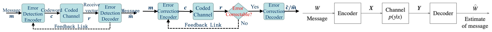
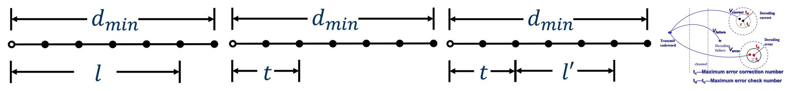

# 9 Channel Coding

<LyricCover
  image="IT-Lecture-9.attachments/1783256241436.JPG"
  title="空が盗まれた日"
  artist="mamomo / nayuta"
  lang="ja"
  furigana="hide"
  netease-url="https://music.163.com/#/song?id=29244121"
>
  <LyricLine
    original="あの｜あぜ道(あぜみち)も風(かぜ)吹(ふ)く街(まち)も砂浜(すなはま)に描(えが)いた絵(え)も奪(うば)っていった"
    translation="田间小道与吹着风的街道，甚至那幅在沙滩上描绘着的画都被夺走了"
  />
  <LyricLine
    original="あの時(とき)眺(なが)めた青空(あおぞら)が未(いま)だに胸(むね)に残(のこ)ってるんだ"
    translation="那时眺望的蓝天，现在还残留在心中"
  />
</LyricCover>

## 章节目录

- [章节目录](#章节目录)
- [9-1 误差控制系统 Error Control Systems](#9-1-误差控制系统-error-control-systems)
  - [9-1-1 ARQ、FEC 与 HEC](#9-1-1-arqfec-与-hec)
  - [9-1-2 随机错误与突发错误 Random and Burst Errors](#9-1-2-随机错误与突发错误-random-and-burst-errors)
  - [9-1-3 最小错误概率译码 Minimum Error Probability Decoding](#9-1-3-最小错误概率译码-minimum-error-probability-decoding)
- [9-2 信道编码定理 Channel Coding Theorem](#9-2-信道编码定理-channel-coding-theorem)
  - [9-2-1 重复码直觉 Repetition Code Intuition](#9-2-1-重复码直觉-repetition-code-intuition)
  - [9-2-2 ML 与 MAP 译码 ML and MAP Decoding](#9-2-2-ml-与-map-译码-ml-and-map-decoding)
  - [9-2-3 有噪信道编码定理 Noisy Channel Coding Theorem](#9-2-3-有噪信道编码定理-noisy-channel-coding-theorem)
- [9-3 线性分组码 Linear Block Codes](#9-3-线性分组码-linear-block-codes)
  - [9-3-1 基本定义 Basic Definitions](#9-3-1-基本定义-basic-definitions)
  - [9-3-2 生成矩阵 Generator Matrix](#9-3-2-生成矩阵-generator-matrix)
  - [9-3-3 校验矩阵与伴随式 Parity Check Matrix and Syndrome](#9-3-3-校验矩阵与伴随式-parity-check-matrix-and-syndrome)
  - [9-3-4 系统码 Systematic Code](#9-3-4-系统码-systematic-code)
- [9-4 检错纠错能力 Error Detection and Correction](#9-4-检错纠错能力-error-detection-and-correction)
  - [9-4-1 最小 Hamming 距离 Minimum Hamming Distance](#9-4-1-最小-hamming-距离-minimum-hamming-distance)
  - [9-4-2 伴随式译码 Syndrome Decoding](#9-4-2-伴随式译码-syndrome-decoding)
  - [9-4-3 重复码性能 Repetition Code Performance](#9-4-3-重复码性能-repetition-code-performance)
  - [9-4-4 Hamming 码 Hamming Code](#9-4-4-hamming-码-hamming-code)

## 9-1 误差控制系统 Error Control Systems

### 9-1-1 ARQ、FEC 与 HEC

信道编码的目标是在有噪信道中提高传输可靠性。它通过加入冗余，使接收端能检测或纠正传输错误。

三类误差控制方式如下：

| 方式 Method | 机制 | 特点 |
| --- | --- | --- |
| **ARQ Automatic Repeat reQuest** | 接收端检测错误，发现错误后请求重传 | 译码简单，需要反馈链路，实时性较弱 |
| **FEC Forward Error Correction** | 接收端直接利用冗余纠错 | 不需要反馈链路，译码复杂度较高 |
| **HEC Hybrid Error Control** | 可纠正则纠正，不可纠正则请求重传 | 兼顾连续性和复杂度 |

FEC 的抽象链路为：

$$
m
\xrightarrow{\mathrm{encoder}}
c
\xrightarrow{\mathrm{coded\ channel}}
r
\xrightarrow{\mathrm{decoder}}
\hat m.
$$

其中 $m$ 是原始消息，$c$ 是码字，$r$ 是接收向量，$\hat m$ 是译码结果。

---

### 9-1-2 随机错误与突发错误 Random and Burst Errors

**随机错误 Random Error** 指错误在传输序列中近似独立、均匀出现。BSC 是随机错误模型的基本例子。

**突发错误 Burst Error** 指一段时间内连续或密集出现错误。无线衰落、强干扰和同步失效都可能导致突发错误。

在 BSC 中，长度为 $n$ 的码块恰好出现 $t$ 个错误的概率为：

$$
P_r(t;p,n)
=
\binom{n}{t}p^t(1-p)^{n-t}.
$$

少于 $t$ 个错误的概率为：

$$
P_r(<t)
=
\sum_{j=0}^{t-1}
\binom{n}{j}p^j(1-p)^{n-j}.
$$

不少于 $t$ 个错误的概率为：

$$
P_r(\ge t)
=
1-P_r(<t).
$$

平均错误个数为：

$$
\bar t
=
\sum_{j=0}^{n}
j\binom{n}{j}p^j(1-p)^{n-j}
=
np.
$$

因此 BSC 的平均误码率仍为 $p$。

---

### 9-1-3 最小错误概率译码 Minimum Error Probability Decoding

接收端收到 $y_j$ 后，若译码规则为：

$$
f(y_j)=x^\ast,
$$

则条件错误概率为：

$$
p(e\mid y_j)
=
1-p(x^\ast\mid y_j).
$$

为了最小化条件错误概率，应选择后验概率最大的输入符号：

$$
\boxed{
x^\ast
=
\operatorname*{arg\,max}_{x_i}p(x_i\mid y_j)
}.
$$

由 Bayes 公式：

$$
p(x_i\mid y_j)
=
\frac{p(y_j\mid x_i)p(x_i)}{p(y_j)}.
$$

由于 $p(y_j)$ 与候选输入无关，最小错误概率准则等价于：

$$
x^\ast
=
\operatorname*{arg\,max}_{x_i}
p(y_j\mid x_i)p(x_i).
$$

若输入符号等概率，则先验概率相同，准则退化为最大似然译码：

$$
\boxed{
x^\ast
=
\operatorname*{arg\,max}_{x_i}
p(y_j\mid x_i)
}.
$$

## 9-2 信道编码定理 Channel Coding Theorem

### 9-2-1 重复码直觉 Repetition Code Intuition

在 BSC 中，若直接传输一个二元符号，最大似然译码的错误概率就是交叉概率 $p$。

把一个符号重复 $3$ 次：

$$
0\mapsto 000,
\qquad
1\mapsto 111.
$$

接收端按多数判决译码。若发送 $000$，错误译成 $111$ 的条件是至少两个位置出错：

$$
P_e^{(3)}
=
\binom{3}{2}p^2(1-p)+p^3.
$$

当 $p=0.1$ 时：

$$
P_e^{(3)}
=
3(0.1)^2(0.9)+(0.1)^3
=
0.028.
$$

错误概率下降，但编码率也下降为：

$$
R_c=\frac{1}{3}.
$$

$n$ 次重复码的一般形式为：

$$
G=[1,1,\cdots,1],
\qquad
R_c=\frac{1}{n}.
$$

若 $n$ 为奇数，多数判决错误概率为：

$$
P_e^{(n)}
=
\sum_{j=\lfloor n/2\rfloor+1}^{n}
\binom{n}{j}p^j(1-p)^{n-j}.
$$

当 $n\to\infty$ 时，若 $p<\frac12$，错误概率趋近于 $0$；同时 $R_c\to0$。重复码说明“加冗余能降错”，也说明“只靠重复会牺牲速率”。

---

### 9-2-2 ML 与 MAP 译码 ML and MAP Decoding

设发送码字为 $x$，接收向量为 $y$。

**最大似然 Maximum Likelihood, ML** 译码为：

$$
\hat x_{\mathrm{ML}}(y)
=
\operatorname*{arg\,max}_{x}p(y\mid x).
$$

ML 默认各码字等概率发送。

**最大后验 Maximum A Posteriori, MAP** 译码为：

$$
\hat x_{\mathrm{MAP}}(y)
=
\operatorname*{arg\,max}_{x}p(x\mid y).
$$

由 Bayes 公式可得：

$$
\hat x_{\mathrm{MAP}}(y)
=
\operatorname*{arg\,max}_{x}
p(y\mid x)p(x).
$$

MAP 把先验概率 $p(x)$ 一并纳入判决。当各码字等概率时，MAP 与 ML 相同。

---

### 9-2-3 有噪信道编码定理 Noisy Channel Coding Theorem

::: definition 有噪信道编码定理 Noisy Channel Coding Theorem

该定理又称**香农第二定理 Shannon's Second Theorem**。

设离散无记忆信道容量为 $C$。若信息传输率 $R<C$，则存在一列编码方案，使码长足够大时译码错误概率满足：

$$
P_e<\varepsilon,
$$

其中 $\varepsilon>0$ 任意小。

若 $R>C$，则无法保证任意小的错误概率。

:::

若发送端每秒发送 $R_t$ 个信道符号，线性分组码的编码率为：

$$
R_c=\frac{k}{n}.
$$

实际信息传输率为：

$$
R=R_tR_c.
$$

单位时间信道容量为 $C_t=R_tC$，因此可靠传输要求：

$$
R_tR_c
\le
R_tC.
$$

即：

$$
\boxed{
R_c\le C
}
\qquad
(\mathrm{bit/channel\ symbol}).
$$

信道编码定理给出存在性结论。具体构造哪一种码、复杂度是否可接受，需要在线性分组码、卷积码、Turbo 码、LDPC 码等具体方案中处理。

## 9-3 线性分组码 Linear Block Codes

### 9-3-1 基本定义 Basic Definitions

**线性分组码 Linear Block Code** 把 $k$ 位消息映射为 $n$ 位码字，记作 $(n,k)$ 码。

消息向量为：

$$
\boldsymbol m
=
(m_0,m_1,\cdots,m_{k-1}).
$$

码字为：

$$
\boldsymbol c
=
(c_0,c_1,\cdots,c_{n-1}).
$$

接收向量为：

$$
\boldsymbol r
=
(r_0,r_1,\cdots,r_{n-1}).
$$

编码率为：

$$
R_c=\frac{k}{n}.
$$

线性分组码的“线性”指所有运算在有限域中进行。二元线性分组码在 $\mathrm{GF}(2)$ 上运算，加法就是异或：

$$
1\oplus1=0,
\qquad
1\oplus0=1.
$$

---

### 9-3-2 生成矩阵 Generator Matrix

$(n,k)$ 线性分组码可用生成矩阵 $\boldsymbol G$ 表示：

$$
\boldsymbol c
=
\boldsymbol m\boldsymbol G.
$$

其中：

$$
\boldsymbol G
=
\begin{bmatrix}
g_{0,0} & g_{0,1} & \cdots & g_{0,n-1}\\
g_{1,0} & g_{1,1} & \cdots & g_{1,n-1}\\
\vdots & \vdots & \ddots & \vdots\\
g_{k-1,0} & g_{k-1,1} & \cdots & g_{k-1,n-1}
\end{bmatrix}.
$$

矩阵大小为 $k\times n$。所有合法码字构成一个 $k$ 维线性子空间，因此：

1. 全零向量 $\boldsymbol\theta$ 是合法码字；
2. 任意两个码字异或后仍是合法码字；
3. 任意码字都是 $\boldsymbol G$ 的行向量线性组合。

例如 $(3,1)$ 重复码的生成矩阵为：

$$
\boldsymbol G=[1\ 1\ 1].
$$

因此：

$$
0\mapsto000,
\qquad
1\mapsto111.
$$

---

### 9-3-3 校验矩阵与伴随式 Parity Check Matrix and Syndrome

对生成矩阵 $\boldsymbol G$，若存在 $(n-k)\times n$ 矩阵 $\boldsymbol H$ 满足：

$$
\boxed{
\boldsymbol G\boldsymbol H^T
=
\boldsymbol 0_{k\times(n-k)}
},
$$

则 $\boldsymbol H$ 称为**校验矩阵 Parity Check Matrix**。

任意合法码字都满足：

$$
\boldsymbol c\boldsymbol H^T
=
\boldsymbol m\boldsymbol G\boldsymbol H^T
=
\boldsymbol 0.
$$

设传输错误图样为：

$$
\boldsymbol e
=
(e_0,e_1,\cdots,e_{n-1}),
$$

其中 $e_i=1$ 表示第 $i$ 位发生错误。接收向量为：

$$
\boldsymbol r
=
\boldsymbol c\oplus\boldsymbol e.
$$

定义**伴随式 Syndrome**：

$$
\boxed{
\boldsymbol s
=
\boldsymbol r\boldsymbol H^T
}.
$$

代入接收向量：

$$
\boldsymbol s
=
(\boldsymbol c\oplus\boldsymbol e)\boldsymbol H^T
=
\boldsymbol c\boldsymbol H^T\oplus\boldsymbol e\boldsymbol H^T
=
\boldsymbol e\boldsymbol H^T.
$$

伴随式只与错误图样有关，与发送的具体码字无关。这是线性分组码译码的基本依据。

---

### 9-3-4 系统码 Systematic Code

若生成矩阵可写为：

$$
\boldsymbol G_s
=
\begin{bmatrix}
\boldsymbol I_k & \boldsymbol Q
\end{bmatrix},
$$

则对应码称为**系统码 Systematic Code**。消息位直接出现在码字前 $k$ 个位置。

对二元系统码，可取校验矩阵：

$$
\boldsymbol H_s
=
\begin{bmatrix}
\boldsymbol Q^T & \boldsymbol I_{n-k}
\end{bmatrix}.
$$

此时：

$$
\boldsymbol G_s\boldsymbol H_s^T
=
\boldsymbol 0.
$$

系统码便于从译码后的码字中直接读出消息位。

## 9-4 检错纠错能力 Error Detection and Correction

### 9-4-1 最小 Hamming 距离 Minimum Hamming Distance

**Hamming 重量 Hamming Weight** 是向量中非零元素个数：

$$
w_H(\boldsymbol a)
=
d_H(\boldsymbol a,\boldsymbol\theta).
$$

**Hamming 距离 Hamming Distance** 是两个等长向量对应位置不同的个数：

$$
d_H(\boldsymbol a,\boldsymbol b)
=
\sum_{i=0}^{n-1}
\mathbf 1(a_i\ne b_i).
$$

对二元向量：

$$
d_H(\boldsymbol a,\boldsymbol b)
=
w_H(\boldsymbol a\oplus\boldsymbol b).
$$

码的最小 Hamming 距离为：

$$
d_{\min}
=
\min_{\boldsymbol c\ne\boldsymbol c'}
d_H(\boldsymbol c,\boldsymbol c').
$$

线性分组码中，任意两个码字之差仍是码字，因此：

$$
\boxed{
d_{\min}
=
\min_{\boldsymbol c\ne\boldsymbol\theta}
w_H(\boldsymbol c)
}.
$$

---

### 9-4-2 伴随式译码 Syndrome Decoding

若码的最小距离为 $d_{\min}$，则：

$$
\boxed{
\text{最多可检测 } d_{\min}-1 \text{ 个错误}
}
$$

以及：

$$
\boxed{
\text{最多可纠正 }
t
=
\left\lfloor\frac{d_{\min}-1}{2}\right\rfloor
\text{ 个错误}
}.
$$

若要求同时纠正 $t$ 个错误并检测 $\ell$ 个错误，需要：

$$
t+\ell
\le
d_{\min}-1,
\qquad
t<\ell.
$$

伴随式译码的流程为：

1. 选取最可能出现的错误图样 $\boldsymbol e$；
2. 计算每个错误图样对应的伴随式 $\boldsymbol s=\boldsymbol e\boldsymbol H^T$；
3. 建立 $(\boldsymbol s,\boldsymbol e)$ 表；
4. 对接收向量计算 $\boldsymbol s=\boldsymbol r\boldsymbol H^T$；
5. 查表得到估计错误图样 $\hat{\boldsymbol e}$；
6. 修正码字：

$$
\hat{\boldsymbol c}
=
\boldsymbol r\oplus\hat{\boldsymbol e}.
$$

在 BSC 且 $p<\frac12$ 时，错误位数越少，错误图样概率越大。因此实际译码通常优先选择 Hamming 重量最小的错误图样。

---

### 9-4-3 重复码性能 Repetition Code Performance

$(n,1)$ 重复码只有两个码字：

$$
\boldsymbol c_0
=
[0,0,\cdots,0],
\qquad
\boldsymbol c_1
=
[1,1,\cdots,1].
$$

最小距离为：

$$
d_{\min}=n.
$$

因此最多可纠正：

$$
t
=
\left\lfloor\frac{n-1}{2}\right\rfloor
$$

个错误。

若 BSC 交叉概率为 $p$，且两个码字等概率发送，采用多数判决时：

$$
P_e
=
\sum_{j=\lfloor n/2\rfloor+1}^{n}
\binom{n}{j}p^j(1-p)^{n-j}.
$$

当 $n\to\infty$ 且 $p<\frac12$ 时：

$$
P_e\to0.
$$

但编码率为：

$$
R_c=\frac{1}{n}\to0.
$$

重复码适合说明可靠性与速率的权衡，不适合作为高效率编码方案。

---

### 9-4-4 Hamming 码 Hamming Code

**Hamming 码 Hamming Code** 是一类线性分组码，满足：

$$
2^{n-k}=n+1.
$$

因此伴随式个数正好等于“无错误”加上所有单比特错误图样的个数。Hamming 码是单比特纠错的完美码。

二元 $(7,4)$ Hamming 码的一种系统生成矩阵为：

$$
\boldsymbol G_s
=
\begin{bmatrix}
1&0&0&0&1&0&1\\
0&1&0&0&1&1&1\\
0&0&1&0&1&1&0\\
0&0&0&1&0&1&1
\end{bmatrix}.
$$

对应校验矩阵可取：

$$
\boldsymbol H_s
=
\begin{bmatrix}
1&1&1&0&1&0&0\\
0&1&1&1&0&1&0\\
1&1&0&1&0&0&1
\end{bmatrix}.
$$

它满足：

$$
\boldsymbol G_s\boldsymbol H_s^T=\boldsymbol 0.
$$

$(7,4)$ Hamming 码的最小距离为：

$$
d_{\min}=3.
$$

因此它可以纠正 $1$ 位错误，也可以检测 $2$ 位错误。

若 BSC 的比特错误概率为 $p$，$(7,4)$ Hamming 码纠正 $0$ 位或 $1$ 位错误后译码正确。译码错误概率为：

$$
\boxed{
P_e
=
1-(1-p)^7-7p(1-p)^6
}.
$$

一般 $(n,k)$ Hamming 码的单错纠正错误概率为：

$$
P_e
=
1-(1-p)^n-np(1-p)^{n-1}.
$$

其编码率为：

$$
R_c
=
\frac{k}{n}
=
1-\frac{\log_2(n+1)}{n}.
$$

当 $n\to\infty$ 时：

$$
R_c\to1.
$$

但单错纠正能力不随码长同比例增长，因此固定交叉概率下：

$$
P_e\to1.
$$

这说明高码率本身不等于高可靠性。码的距离结构和译码能力必须同时考虑。
