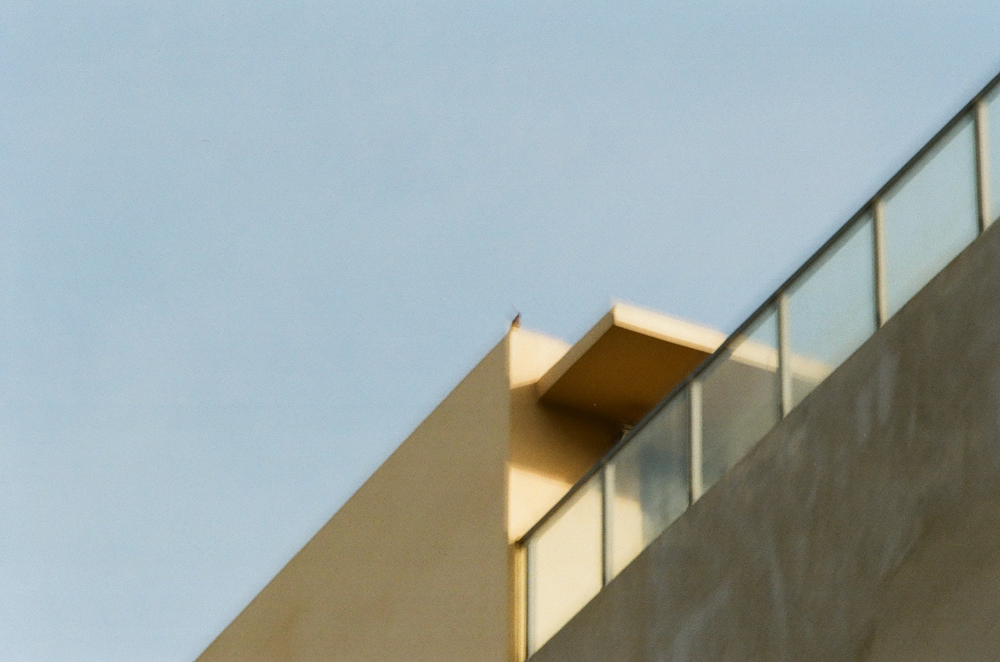

# 通信电路设计 Communication Circuit Design UESTC 3029 / UESTCHN3004

---

> [!TIP]
> 如果你看到这里，那就说明你已经活过了紧张刺激的工财。
>
> 那么，接下来是什么呢...？
>
> 祝你好运。

<CourseIndex
  course="CCD"
  basePath="Y3S2/CCD"
  :groups="[
    {
      title: 'Part 1 - Electronic Comms, Semiconductors, Transistors, Amplifiers',
      items: [
        {
          code: 'Lecture 1',
          title: '课程简介',
          subtitle: 'Introduction',
          link: 'Part 1/CCD Lecture 1 Introduction.md',
          cover: 'Part 1/CCD Lecture 1 Introduction.attachments/1779783811122.PNG'
        },
        {
          code: 'Lecture 2',
          title: '电子通信',
          subtitle: 'Electronic Communications',
          link: 'Part 1/CCD Lecture 2 Electronic Communications.md',
          cover: 'Part 1/CCD Lecture 2 Electronic Communications.attachments/1778848682009.jpg'
        },
        {
          code: 'Lecture 2b',
          title: '半导体基础',
          subtitle: 'Semiconductors Basics',
          link: 'Part 1/CCD Lecture 2b Semiconductors Basics.md',
          cover: 'Part 1/CCD Lecture 2b Semiconductors Basics.attachments/1779784870101.JPG'
        },
        {
          code: 'Lecture 3-4',
          title: '晶体管',
          subtitle: 'Transistors',
          link: 'Part 1/CCD Lecture 3-4 Transistors.md',
          cover: 'Part 1/CCD Lecture 3-4 Transistors.attachments/1779784088824.jpg'
        },
        {
          code: 'Lecture 5-6',
          title: '放大器',
          subtitle: 'Amplifiers',
          link: 'Part 1/CCD Lecture 5-6 Amplifiers.md',
          cover: 'Part 1/CCD Lecture 5-6 Amplifiers.attachments/1780057676448.JPG'
        }
      ]
    },
    {
      title: 'Part 2 - Mixers, Matching Networks, Oscillators',
      items: [
        {
          code: 'Lecture 7',
          title: '混频器',
          subtitle: 'Mixers',
          link: 'Part 2/CCD Lecture 7 Mixers.md',
          cover: 'Part 2/CCD Lecture 7 Mixers.attachments/1780057844904.PNG'
        },
        {
          code: 'Lecture 8',
          title: 'LC 电路与匹配网络',
          subtitle: 'LC Circuits and Matching Networks',
          link: 'Part 2/CCD Lecture 8 LC Circuits and Matching Networks.md',
          cover: 'Part 2/CCD Lecture 8 LC Circuits and Matching Networks.attachments/1780209189821.JPG'
        },
        {
          code: 'Lecture 9',
          title: '振荡器',
          subtitle: 'Oscillators',
          link: 'Part 2/CCD Lecture 9 Oscillators.md',
          cover: 'Part 2/CCD Lecture 9 Oscillators.attachments/1780209759050.jpg'
        },
        {
          code: 'Lecture 10',
          title: '中期复习',
          subtitle: 'Middle Revision',
          link: 'Part 2/CCD Lecture 10 Revision.md',
          cover: 'Part 2/CCD Lecture 9 Oscillators.attachments/1780209422588.JPG'
        }
      ]
    },
    {
      title: 'Part 3 - Modulation and Antennas',
      items: [
        {
          code: 'Lecture 11-12',
          title: '幅度调制',
          subtitle: 'Amplitude Modulation',
          link: 'Part 3/CCD Lecture 11-12 Amplitude Modulation.md',
          cover: 'Part 3/CCD Lecture 11-12 Amplitude Modulation.attachments/1780674328208.JPG'
        },
        {
          code: 'Lecture 13',
          title: '单边带通信',
          subtitle: 'Single-Sideband Communication (SSB)',
          link: 'Part 3/CCD Lecture 13 Single-Sideband Communication SSB.md',
          cover: 'Part 3/CCD Lecture 13 Single-Sideband Communication SSB.attachments/1780727188147.JPG'
        },
        {
          code: 'Lecture 14',
          title: '频率调制与相位调制',
          subtitle: 'Frequency Modulation (FM) \u0026 Phase Modulation (PM)',
          link: 'Part 3/CCD Lecture 14 Frequency Modulation and Phase Modulation.md',
          cover: 'Part 3/CCD Lecture 14 Frequency Modulation and Phase Modulation.attachments/1780839332491.png'
        },
        {
          code: 'Lecture 15',
          title: '电路中的天线',
          subtitle: 'Antennas in a Circuit',
          link: 'Part 3/CCD Lecture 15 Antennas in a Circuit.md',
          cover: 'Part 3/CCD Lecture 15 Antennas in a Circuit.attachments/1780840132059.JPG'
        }
      ]
    },
    {
      title: 'Part 4 - PLL, DAC, ADC and Converter Errors',
      items: [
        {
          code: 'Lecture 16',
          title: '锁相环',
          subtitle: 'Phase-Locked Loop (PLL)',
          link: 'Part 4/CCD Lecture 16 Phase-Locked Loop PLL.md',
          cover: 'Part 4/CCD Lecture 16 Phase-Locked Loop PLL.attachments/1781247638338.PNG'
        },
        {
          code: 'Lecture 18',
          title: '数模转换',
          subtitle: 'Digital to Analog Conversion',
          link: 'Part 4/CCD Lecture 18 Digital to Analog Conversion.md',
          cover: 'Part 4/CCD Lecture 18 Digital to Analog Conversion.attachments/1781248048842.jpg'
        },
        {
          code: 'Lecture 19-20',
          title: 'ADC 与转换器误差',
          subtitle: 'ADC and Converter Errors',
          link: 'Part 4/CCD Lecture 19-20 ADC and Converter Errors.md',
          cover: 'Part 4/CCD Lecture 19-20 ADC and Converter Errors.attachments/1781248130127.jpg'
        }
      ]
    }
  ]"
/>

**本笔记基于 2026 年春季格拉斯哥学院通信电路设计课件及教材整理。**

> [!TIP]
> 人生的意义是什么呢？

如果对你有帮助，就请留下一些评论或者表情吧，我会非常感谢的（真的非常非常感谢！）
